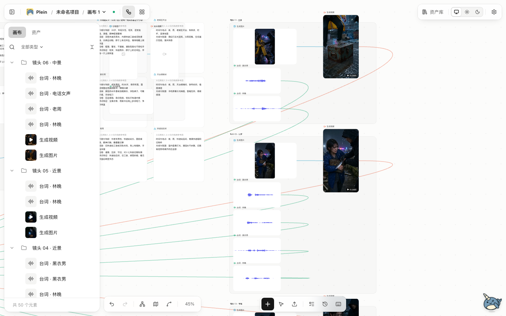
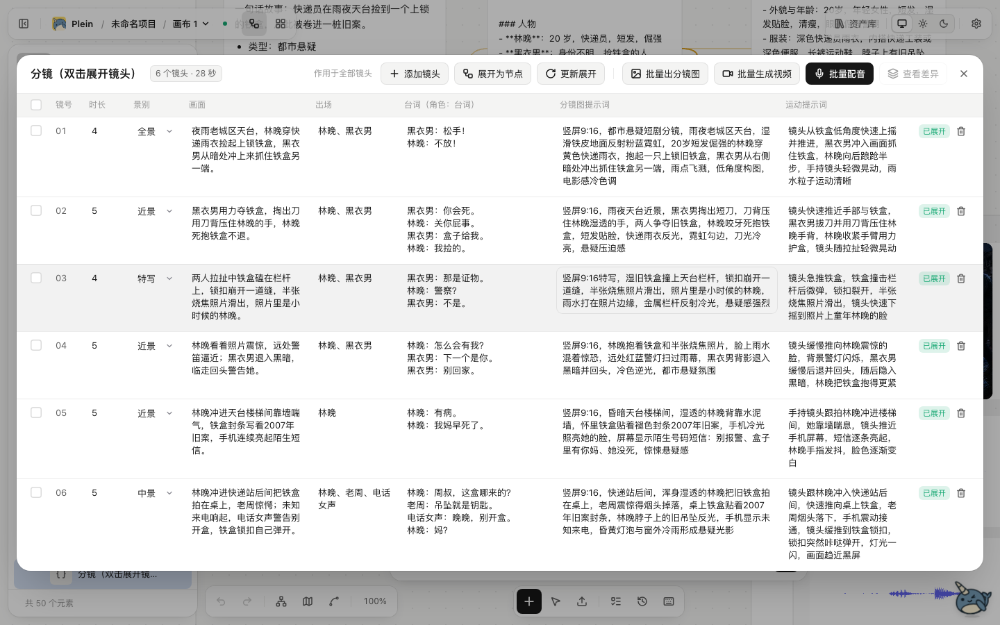
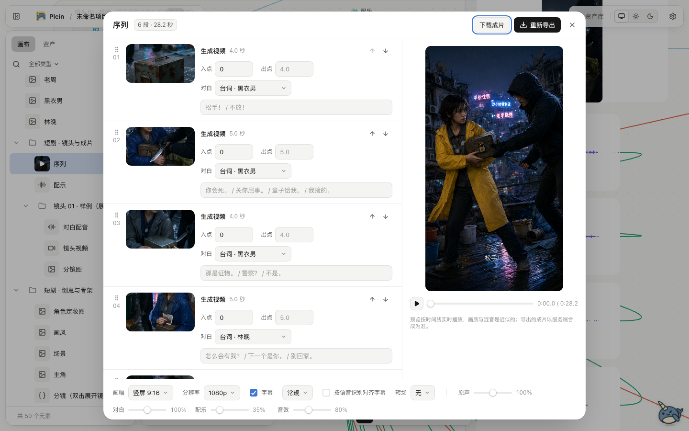

<div align="center">


# Plein

**本地优先的 AI 短剧画布。**<br/>
把创意、剧本、角色、分镜、镜头、配音和成片放在同一张无限画布上，每一步都能看、能改、能单独返工。

[](https://github.com/hoobnn/plein/actions/workflows/ci.yml)
[](LICENSE)

%20%7C%20自部署-lightgrey>)

[快速开始](#快速开始) · [功能](#功能) · [路线图](#路线图) · [文档](#文档) · [参与开发](CONTRIBUTING.md)

</div>

> [!NOTE]
> Plein 即将发布 0.1.0，还没有正式版本。主流程已在真实平台（阿里云百炼 + 豆包语音）上跑通一部 6 镜头竖屏样片；0.x 期间数据格式仍可能调整，见[路线图](#路线图)。



## 为什么是 Plein

- **流程摊在画布上**：剧本、角色卡、分镜表、镜头图、视频、配音、序列都是画布上连好线的节点，没有黑盒。改了哪一步，下游哪些需要重跑一目了然。
- **先审再花钱**：插入模板只搭骨架，不会自动调用模型。先审分镜和镜头图，再分批生成视频和配音；任何一个镜头都能换候选、重生成或手动替换。
- **数据在你自己手里**：一个 Node 进程、一个 SQLite 文件、一个素材目录。密钥只存在本机服务端，不进画布、不进浏览器。
- **接国内主流平台**：火山方舟、豆包语音、阿里云百炼、MiniMax 开箱可选，节点按所选模型自动给出参数。
- **让 AI 替你点按钮**：内置智能体「小满」能读画布、建节点、跑分镜、加工素材；也可以交给本机已登录的 Claude Code / Codex，或通过 MCP 让 Cursor、Claude Desktop 直接操作画布。

## 功能

### 画布

- PixiJS（WebGL）渲染的无限画布，基于 Yjs 的文档模型：撤销重做、刷新和重启不丢、多标签页同步
- 图片、视频、音频、Markdown 素材拖拽、粘贴或整个文件夹导入；视频和音频用自绘播放器
- 小地图、图层侧栏、故事板视图、整理画布、多选浮动工具条、⌘K 命令面板、浅色 / 深色主题

### 生成节点

- 文本、对话（LLM）、图片、视频、配音、配乐节点；参数表单按所选模型生成，9 种画幅
- 视频模式由你指定：文生视频、首帧、首尾帧、多图参考，可选生成数量和同步音频
- 提示词里 `@` 引用角色 / 场景 / 道具 / 风格卡，重名可消歧；行首 `/` 选用三视图、表情九宫格、多机位、四格剧情等预设
- 提示词优化与翻译；每次生成保留候选和历史，下游只用你采用的那一版

### 短剧流水线

| 分镜表                                                          | 序列编辑器                                                                |
| --------------------------------------------------------------- | ------------------------------------------------------------------------- |
|  |  |

- 一键插入短剧模板：创意 → 剧本 → 角色与场景抽取 → 设定卡 → 分镜 → 镜头 → 序列
- 分镜表格编辑；展开成镜头节点后，表格再改会显示差异，可以只同步你没手改过的字段
- 镜头图、视频、配音分阶段批量生成，失败的单独重试
- 序列编辑器：排序、入出点、对白 / 配乐 / 音效三条音轨、字幕样式、淡入淡出与叠化转场，浏览器内按导出时间线预览
- 服务端 ffmpeg 导出 MP4（9:16 / 16:9，1080p / 720p），烧录中文字幕，可按语音识别对齐字幕时间轴

### 素材加工

- 图片：裁剪、旋转、镜像、宫格切分
- 视频：截取、变速、抽帧入库、音视频分离
- 音频：截取、手动切分、保音调变速

加工结果都是带来源记录的新素材，原文件不动。

### 项目与资产库

- 一个项目一部片子，下面可以有多张画布
- 资产库分角色、场景、道具、风格、特效五类，跨画布、跨项目复用。角色有全身 / 半身 / 设定图 / 情绪九宫格槽位、标签和音色；画布卡片和资产库可以双向同步

### 运行与任务

- 单节点运行、运行到此处（含上游）、运行下游、整组运行；没改动的节点命中缓存，不重复花钱
- 任务排在 SQLite 里，关掉页面照常跑，服务重启后接着查询远端任务
- 任务面板显示进度、自动重试和失败原因；参数或上游改过的节点标出「需要重跑」

### 智能体「小满」

- 内置智能体：用已启用平台的对话模型（支持工具调用的）操作画布，不用另装软件
- 本机 CLI：调用这台电脑上已登录的 Claude Code 或 Codex，用你自己的账号和额度
- 对外开放 MCP：Claude Code、Claude Desktop、Cursor 等可以连进本机 Plein
- 花钱和删除前先确认；支持计划模式；一轮改动可以整轮撤销

详见 [智能体与 MCP](docs/guide/agent.md)。

### 模型平台

| 平台       | 对话               | 图片             | 视频               | 语音与音频                             |
| ---------- | ------------------ | ---------------- | ------------------ | -------------------------------------- |
| 火山方舟   | Doubao Seed        | Seedream 5.0     | Seedance 2.0 / 2.5 | —                                      |
| 豆包语音   | —                  | —                | —                  | TTS 2.0、Seed Audio 音乐音效、极速识别 |
| 阿里云百炼 | 千问（含工具调用） | Qwen Image、万相 | Wan 3.0            | Qwen TTS                               |
| MiniMax    | M3 / M2.7          | image-01         | H3 / H3-Max        | speech-2.8、Music 3.0                  |

各平台的参数映射与能力边界见 [模型平台接入](docs/guide/providers.md)。新平台、节点和模板可以通过插件接入，见 [插件](docs/dev/plugins.md)。

## 快速开始

### 桌面端（macOS，推荐）

双击即用，自带 ffmpeg；从 0.1.0 起会自动检查更新。安装包（Apple 芯片）随正式版本发布在 [Releases](https://github.com/hoobnn/plein/releases)；在此之前可以从源码打包：`pnpm install && pnpm dist:desktop`。Intel Mac 和 Windows 暂未提供。

### Docker 自部署

```bash
git clone https://github.com/hoobnn/plein.git && cd plein
docker compose up -d
```

不提供预构建镜像，`compose` 会从源码构建。打开 <http://localhost:8787>，镜像内置 ffmpeg 和中文字体，画布、素材和数据库都在 `plein-data` 卷里，备份它即可。

默认只绑定本机且免登录。要让其他设备访问，按 `compose.yaml` 里的注释改端口并删掉 `PLEIN_AUTH`，首次访问会要求创建所有者账号。

### 从源码运行

需要 Node ≥ 24、pnpm 12 和本机 ffmpeg（用于视频封面、音频波形和导出；烧字幕需要带 libass 的构建）。

```bash
pnpm install && pnpm build && pnpm start   # http://localhost:8787
```

### 接入模型

1. 打开设置 →「模型平台」，填写密钥，保存并启用。四家真实平台默认关闭，密钥不需要放环境变量。
2. 新建项目，在空白处双击插入「短剧模板」，或从空白画布开始。
3. 在节点的生成器里选择模型，运行。

<details>
<summary><b>环境变量</b></summary>

| 变量                                       | 默认                               | 说明                                                   |
| ------------------------------------------ | ---------------------------------- | ------------------------------------------------------ |
| `PLEIN_HOST` / `PLEIN_PORT`                | `127.0.0.1` / `8787`               | 监听地址                                               |
| `PLEIN_DATA_DIR`                           | `./data`                           | 数据目录                                               |
| `PLEIN_AUTH`                               | 本机地址为 `none`，否则 `password` | `password` 时用 Better Auth 登录，只允许一个所有者账号 |
| `PLEIN_PUBLIC_URL`                         | 按请求推断                         | 反向代理后的对外地址                                   |
| `PLEIN_ALLOWED_HOSTS`                      | 空                                 | 免登录模式下额外允许的主机名，逗号分隔                 |
| `PLEIN_MAX_UPLOAD_MB`                      | `2048`                             | 单个文件上限                                           |
| `PLEIN_MAX_JOBS`                           | `4`                                | 同时运行的节点任务数上限                               |
| `PLEIN_FFMPEG_PATH` / `PLEIN_FFPROBE_PATH` | 从 `PATH` 查找                     | ffmpeg / ffprobe 可执行文件                            |
| `PLEIN_AGENT`                              | 免登录模式下开启                   | 设为 `0` 关闭本机 CLI 智能体                           |

</details>

<details>
<summary><b>数据存在哪</b></summary>

- Docker：`plein-data` 卷
- 源码运行：仓库下的 `data/`，可用 `PLEIN_DATA_DIR` 覆盖
- 桌面端：macOS `~/Library/Application Support/plein/data`，Windows `%APPDATA%\plein\data`，Linux `~/.config/plein/data`

目录结构在三种方式下相同，可以互相拷贝。里面是 `plein.db`（SQLite）、`assets/`（按内容哈希存的素材）、`exports/` 和平台密钥文件（权限 600）。

</details>

## 路线图

- [x] 无限画布、四类素材、项目与资产库
- [x] 四家模型平台、生成节点、候选与历史
- [x] 任务队列、缓存、整组运行、重启恢复
- [x] 短剧模板、分镜同步、分阶段批量生成、序列导出 MP4
- [x] 图片 / 视频 / 音频基础加工
- [x] 智能体小满、本机 Claude Code / Codex、对外 MCP
- [x] macOS 桌面端安装包、签名与公证流水线
- [x] 真实平台 6 镜头样片验收、界面测试进 CI、自动更新
- [ ] **0.1.0**：发布 macOS（Apple 芯片）安装包
- [ ] **0.2.0**：分镜组与拼图、项目包迁移、区域编辑、取帧续镜、运镜 / 风格预设、第三方插件
- [ ] **之后**：全景、3D 导演台、深度参考、原生片段重拍、智能剪辑

完整规划、决策记录和验收状态见 [0.1.0 路线图](docs/plan/roadmap-0.1.0.md) 与 [验收记录](docs/plan/acceptance-0.1.0.md)。

## 文档

完整索引见 [docs/](docs/README.md)。常用的几篇：

- [模型平台接入](docs/guide/providers.md)：各平台能力、配置与边界
- [智能体与 MCP](docs/guide/agent.md)：小满、本机 CLI、对外 MCP
- [0.1.0 路线图](docs/plan/roadmap-0.1.0.md)：范围、里程碑、决策记录与发版清单
- [长期架构](docs/dev/architecture.md)：文档模型、渲染、工作流、后端

## 参与开发

开发环境、命令、代码结构、分支与提交规范见 [CONTRIBUTING.md](CONTRIBUTING.md)。

## 技术栈

React 19 · Vite+ · Tailwind v4 · PixiJS v8 · Yjs · Hono · SQLite（Drizzle）· Better Auth · ffmpeg · Electron

## 许可证

[GNU AGPL v3.0](LICENSE)：允许商用、修改与分发，但衍生作品（包括通过网络提供的服务）必须以相同许可证开源。
