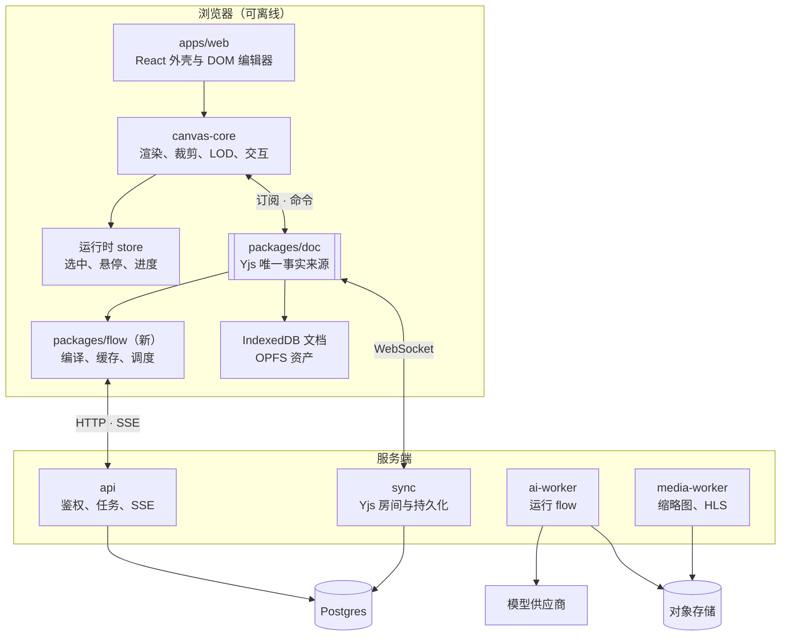

# plein 长期技术架构规划

2026-10-11 · hoobnn

## 目标

plein 是一块“可执行的画布”：同一个 Yjs 文档里既放图片、视频、Markdown 等视觉内容，也放生成器和 LLM 节点组成的工作流，节点输出直接落成画布上的新元素。架构要守住三件事：

1. **丝滑**：10 万级元素的画布平移缩放保持 120fps，交互期间 React 零重渲染。
2. **可执行**：任意子图可确定性地执行、缓存、重放，结果可追溯到输入和模型版本。
3. **本地优先、可协作**：离线可用，多人实时协作是同一数据模型的自然延伸。

本文是 12 到 18 个月的方向性规划，具体实现以各阶段设计评审为准。0.1.0 面向本地自部署，对后端与存储做了收窄，见 [roadmap-0.1.0.md](roadmap-0.1.0.md)。

## 现状

相机和输入已脱离 React，渲染层订阅 `elements` 增量更新，端口与连线已可用；工作流、后端和资产系统还是空白。

| 模块 | 已有 | 主要缺口 |
| --- | --- | --- |
| `apps/web` | Vite + React 19 + Tailwind v4 + zustand，`CanvasView` 挂载引擎并写入演示元素 | 工具栏、选择/变换、节点表单、持久化、账号 |
| `packages/canvas-core` | PixiJS v8（WebGPU 优先）、相机、触控板/惯性输入、点阵、占位矩形、端口与贝塞尔连线、DOM 覆盖层 | 按类型渲染、视口裁剪、LOD、命中测试、纹理管理 |
| `packages/doc` | `elements`、`edges` 两个 `Y.Map`，带类型的 `Port`，`UndoManager`、`connectPorts` | 元素整对象存入（并发会互相覆盖）、无 schema 版本、无 z 序与父子关系、无持久化 |
| `apps/server` | 尚未创建（0.1.0 为 Node + Hono 单进程，见 roadmap-0.1.0.md） | 全部待建 |
| 工程 | pnpm workspace、TS 7、commitlint + husky、CI（Node 26） | 测试、lint、性能基准 |

## 架构原则

1. **文档是唯一事实来源**：画布、工作流图、节点参数都在 Yjs 里；渲染、UI、执行引擎都是订阅者。运行时状态（执行进度、选中、悬停）不进文档。
2. **热路径不过 React**：相机、拖拽、连线预览由 canvas-core 直接驱动；React 只管外壳和按 LOD 挂载的编辑表单。
3. **二进制不进文档**：文档只存 `assetId`，资产内容寻址、不可变。
4. **服务端可选**：纯前端 + IndexedDB 即可完整使用；服务端提供同步、存储和需要密钥/算力的 AI 执行。
5. **工作流确定性**：节点结果由“类型 + 参数 + 输入哈希 + 模型版本”唯一确定。
6. **核心包与框架无关**：`doc`、`canvas-core`、`flow` 不依赖 React，可在 Worker、服务端、测试中复用。

## 总体架构



新增两个包：`packages/flow`（工作流引擎）和 `packages/protocol`（前后端共享的接口 schema）。

## 文档模型（packages/doc）

最紧迫的改动：元素从“整对象存入 `Y.Map`”改为“每个元素一个嵌套 `Y.Map`”，否则一人拖位置、一人改参数时后写者会整个覆盖前者。

```
Y.Doc
├─ meta: Y.Map            schemaVersion, title, createdAt
├─ elements: Y.Map<id, Y.Map>
│    kind, x, y, w, h, rotation, z, parentId, locked
│    assetId? · text?: Y.Text · params?: Y.Map · ports? · nodeType?, nodeVersion?
├─ edges: Y.Map<id, {from:[el,port], to:[el,port]}>
└─ runs: Y.Map<elementId, {runId, outputHash, status}>   最后一次成功结果
```

- z 序用分数索引；分组用 `parentId` + 局部坐标，写入时防环。
- 删除元素时同一事务删相关边；并发产生的悬空边读取时忽略、惰性清理。
- 上层只用命令式 API（`moveElements`、`connect`、`setParam`…），每个命令一个带 origin 的 `transact`；读取侧提供快照 + 按帧归并的变更事件。
- `meta.schemaVersion` 顺序迁移，节点参数由 `nodeVersion` 自行迁移；旧客户端遇到高版本只读打开。
- 持久化：本地 `y-indexeddb`，云端自建 sync 服务；Awareness 传光标与选中；`UndoManager` 只追踪本地 origin。超大文档（约 5 万元素以上）按 Frame 拆 subdocs，放到阶段四。

## 渲染与交互（packages/canvas-core）

canvas-core 演进为场景引擎：从 doc 得到世界状态，维护场景图和空间索引，对外只暴露工具和事件，不暴露 Pixi 对象。

| 层 | 职责 |
| --- | --- |
| SceneSync | 订阅 doc、按帧归并，维护 `id → SceneNode` 与 R-tree（rbush） |
| Renderers | 按 `kind` 注册：图片、视频、Markdown、节点、连线、Frame |
| Culling + LOD | 只渲染视口内元素，按屏幕尺寸切换缩略图级别与 DOM 表单挂载 |
| Interaction | 命中测试、工具状态机（选择、框选、变换、连线、平移）、吸附 |
| TextureManager | 按 assetId + 级别加载纹理，LRU 淘汰，GPU 内存预算 |

关键策略：

- 拖拽期间只改场景节点本地偏移，松手一次写入；协作时 50ms 节流写入。
- 图片先显示 ThumbHash，再按屏幕尺寸取缩略图级别，Worker 内 `createImageBitmap` 解码。
- 视频远景显示封面，只有聚焦的视频解码上纹理，同时播放数有上限。
- Markdown 编辑时用绑定 `Y.Text` 的 DOM 编辑器，非编辑时渲染为纹理缓存。
- WebGPU 不可用时回退 WebGL2；保留迁入 OffscreenCanvas + Worker 的可能。

## 工作流引擎（packages/flow）

不依赖 UI 的纯 TS 包，浏览器和服务端共用：输入 doc 里的元素和边，输出执行计划和事件流。

**节点类型**是一个描述对象：`type`、`version`、参数 schema（zod/valibot，同时驱动校验和表单）、端口、`execute(inputs, params, ctx)`、参数迁移。首批节点：Prompt（本地）、LLM、文生图/图生图、图像处理（服务端），图生视频放到阶段三。

**执行模型**：

1. 编译：从目标节点向上游取子图，校验无环、端口类型和参数。
2. 缓存：键 = hash(类型@版本, 规范化参数, 输入内容哈希, 模型)；随机节点把 seed 纳入参数。
3. 调度：拓扑排序后并发执行，按供应商限速和用户配额限流。
4. 落地：输出写入资产系统，指针写回 `runs`；可“铺开”为独立画布元素并连来源边。
5. 进度经 SSE 只进运行时 store；run 可取消，失败不影响无关分支。

服务端用统一 Provider 接口包装各家模型，节点只声明能力；支持 BYOK，密钥加密存服务端。分钟级长任务一律走队列。

## 后端与资产

| 服务 | 技术 | 职责 |
| --- | --- | --- |
| `api` | Node + Hono | 鉴权、画布元数据、上传签名、AI 任务、SSE、配额 |
| `sync` | Node WebSocket + Yjs | 文档房间、权限、增量持久化与快照 |
| `ai-worker` | Node + `packages/flow` | 取任务、调用 Provider、产出写对象存储 |
| `media-worker` | libvips + ffmpeg | 缩略图金字塔、ThumbHash、封面、HLS |

早期合并为一个 Node 进程（`apps/server`）部署，代码从第一天分开。依赖只有 Postgres（元数据、Yjs 更新、`SKIP LOCKED` 任务队列）和 S3 兼容对象存储（MinIO / R2），适合 AGPL 自托管。

资产：

- `assetId` 为内容哈希，写入即不可变，去重和缓存键自然成立。
- 上传：客户端算哈希 → 查重 → 预签名直传 → media-worker 生成衍生物（按 `assetId/variant` 寻址）；完成前用本地 blob URL 显示。
- 纯本地模式资产存 OPFS，登录后后台上传。
- 无引用资产超过保留期（暂定 30 天）再删；AI 产出带 runId、模型、参数哈希，可溯源。

## 扩展性

- 一个元素类型 = doc schema + 渲染器 + 可选 DOM 编辑器 + 可选 flow 节点，内置类型全部走同一注册机制。
- 新增模型供应商只需实现 Provider 接口。
- 阶段四对外开放：第三方节点以 webhook 接入，前端只开放声明式表单。
- 一组节点可打包为组合节点，发布为模板。

## 横切关注点

**性能预算**（待基准验证）：10 万元素（可见 2000）平移 ≥ 120fps；交互期间 React 重渲染 0 次；1 万元素画布本地打开 < 1.5s；GPU 纹理默认上限 512MB；首屏 JS gzip < 300KB。

**测试**：`doc`、`flow` 用 Vitest（含双 Y.Doc 并发与迁移）；`canvas-core` 用 Playwright 截图与交互测试，合成大画布基准进 CI；服务端用 mock Provider 跑集成测试。

**安全**：sync 层校验只读/可编辑；Markdown 做 HTML 消毒、外链图片经代理；密钥只在 ai-worker 解密；LLM 输出只作数据，不直接驱动画布操作；配额按用户和供应商记账。

**运维**：OpenTelemetry 追踪每个 run 的延迟、成本、失败；提供 Docker Compose（web + 服务 + Postgres + MinIO）自托管。

## 路线图

| 阶段 | 内容 | 进入下一阶段的门槛 |
| --- | --- | --- |
| 一 地基（0–2 月） | 嵌套 `Y.Map` 与命令式 API、schema 迁移；按类型渲染、裁剪、R-tree；选择/框选/变换/连线；IndexedDB；Vitest、Playwright、性能基准 | 1 万元素平移不掉帧，刷新不丢数据 |
| 二 工作流（2–5 月） | `packages/flow`；api + ai-worker、任务队列、SSE；Prompt/LLM/文生图/图生图；内容哈希上传与缩略图 | 提示词 → 图片 → 画布端到端跑通，未改动节点命中缓存 |
| 三 协作与内容（5–9 月） | sync 多人编辑与只读分享；Markdown、视频与 HLS；长任务节点；组合节点；元素插件化 | 两人同时编辑同一节点不丢修改，长任务可取消重试 |
| 四 规模与生态（9–18 月） | subdocs 按需加载；OffscreenCanvas 渲染；第三方节点与 Provider 开放；自托管与托管版 | — |

月份是建议节奏，不是承诺。阶段一的 doc 模型改造需一并迁移 `connectPorts` 和 canvas-core 的订阅逻辑。

## 待定决策

| 问题 | 建议 | 截止 |
| --- | --- | --- |
| 同步服务：自建 vs Hocuspocus 等 | 自建薄层，保持自托管友好 | 阶段二 |
| 工作流执行位置 | 同一引擎两端跑，需密钥的节点默认服务端 | 阶段二 |
| 富文本编辑器 | Tiptap/ProseMirror 或 Lexical | Markdown 元素开工前 |
| 资产保留期 | 30 天（待定） | 上线云存储前 |
| 官方托管版与计费 | 未定，影响多租户设计 | 阶段三前 |
