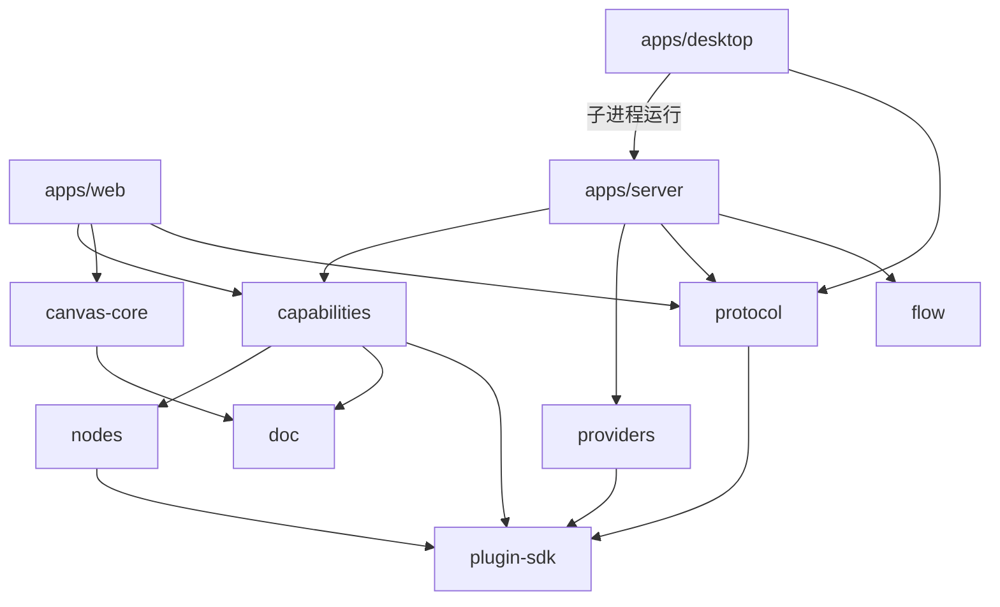
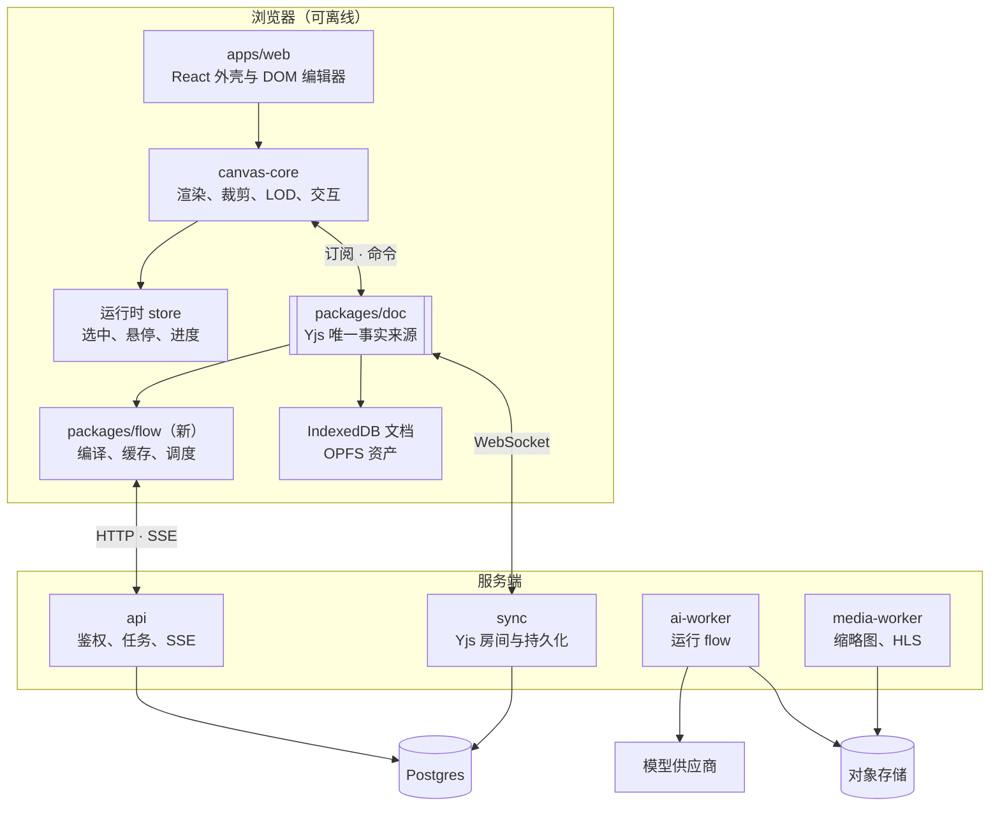

# plein 长期技术架构规划

2026-10-11 · hoobnn

## 目标

plein 是一块“可执行的画布”：同一个 Yjs 文档里既放图片、视频、Markdown 等视觉内容，也放生成器和 LLM 节点组成的工作流，节点输出直接落成画布上的新元素。架构要守住三件事：

1. **丝滑**：10 万级元素的画布平移缩放保持 120fps，交互期间 React 零重渲染。
2. **可执行**：任意子图可执行、缓存和追溯；本地确定性加工可重现，远端生成保留实际输入、调用记录与产物，不承诺重复调用结果相同。
3. **本地优先、可协作**：离线可用，多人实时协作是同一数据模型的自然延伸。

本文是 12 到 18 个月的方向性规划，具体实现以各阶段设计评审为准。2026-10-14 的下一阶段范围与验收合同见 [0.2.0 路线图](../plan/roadmap-0.2.0.md)。0.1.0 面向本地自部署，对后端与存储做了收窄，见 [roadmap-0.1.0.md](../plan/roadmap-0.1.0.md)。

## 现状

2026-10-17 已落地并通过本地集成验收的稳定输入、媒体资源治理、Agent 执行事实、跨画布素材与检查点，以 [BeefTV 对照优化](../plan/beeftv-optimization.md)及其证据为准。下表是历史快照；真实平台与硬件性能仍按各自的验收边界记录。

本轮实现保留现有引擎和插件边界：

- `doc` schema v3 为输入边保存分数顺序，前后端都通过 `inputEdges` 读取。布局变化不再参与生成语义。
- `canvas-core` 的 Scene 只因几何字段更新空间索引。每个 Engine 租用共享 `TexturePool`，离屏 body 延迟回收；资源和预览呈现状态通过 `engine.stats` 观测。
- Agent 用不可变轮次对象约束异步操作，工具与审批事实写入 `agent_turns`。内置模型上下文有字节、图片与调用数上限；CLI 每轮独立进程及令牌，并复用 CLI 会话上下文。
- SQLite `assets` 是媒体库存事实来源，`media_sources` 为可重建投影。文档增量与对应媒体投影在同一事务写入，失败时保留增量等待重试。启动回填不阻塞既有创作接口。
- `canvas_checkpoints` 保存完整 Yjs 状态和历史关联，`checkpoint_assets` 固定素材引用。保存用含 DeleteSet 的 Snapshot 检查同步屏障，恢复只创建新画布；有检查点的 `.plein` 包使用 manifest v2，仍可读取 v1。
- 首页、编辑器与重型面板按需加载，生产构建自动统计首页静态依赖闭包的 gzip 大小。CI 对真实入库媒体运行三轮首屏与交互基准，并硬性检查失败预览和资源退出清理。

下表为 2026-10-12 的架构快照，2026-10-14 补正浏览器缓存状态。0.1 已发布，真实验收以 [验收记录](../plan/acceptance-0.1.0.md) 为准；表中其他性能与工程缺口需实施时重新核对。

| 模块                   | 已有                                                                                                          | 主要缺口                                                                               |
| ---------------------- | ------------------------------------------------------------------------------------------------------------- | -------------------------------------------------------------------------------------- |
| `apps/web`             | React 外壳、工具栏与面板、节点表单、分镜表、序列编辑、资产库、任务面板、本机智能体，经 `api/client.ts` 调后端 | 已接入 y-indexeddb 文档缓存；断线编辑、重连、schema 与缓存失效在 0.1.3 验收            |
| `packages/canvas-core` | PixiJS v8、相机与惯性输入、rbush 场景索引、视口裁剪与 LOD、选择/框选/吸附/缩放、端口与连线、DOM 覆盖层        | 纹理管理与性能基准（第三步性能审查）                                                   |
| `packages/doc`         | 每元素一个嵌套 `Y.Map`、命令式 API、z 序与父子关系、schema 迁移、按帧合并的变更订阅、`portsCompatible`        | —                                                                                      |
| `packages/flow`        | 纯 TS 的 DAG 调度（`runDag`）、依赖图；目前只在服务端（任务运行、插件宿主）调用                               | 浏览器侧编译与用量预估                                                                 |
| `apps/server`          | Node + Hono 单进程：Yjs 房间（带租约）、SQLite 任务队列与重试、插件宿主、资产与衍生物、导出、本机智能体       | Yjs 更新逐条同步写库，大文档导入时会占住事件循环，需要合并写入；整组运行状态靠前端轮询 |
| 工程                   | Vite+（Oxlint、Oxfmt、Vitest、tsdown）、Playwright（mock，已进 CI）、commitlint + husky、CI（Node 26）        | 性能基准进 CI                                                                          |

## 包与依赖



| 包                      | 职责                                                                                            |
| ----------------------- | ----------------------------------------------------------------------------------------------- |
| `packages/plugin-sdk`   | 插件公开 API：清单、节点、Provider、执行器、能力的类型与注册方式                                |
| `packages/doc`          | Yjs 文档模型与命令式 API                                                                        |
| `packages/canvas-core`  | 画布渲染与交互内核                                                                              |
| `packages/flow`         | 依赖图、调度、缓存键                                                                            |
| `packages/nodes`        | 内置节点声明与短剧领域约定（模板、资产库分类、角色档案、分镜、序列），纯数据 + 纯函数，不碰 Yjs |
| `packages/capabilities` | 对文档的操作（能力），界面、⌘K、内置智能体、对外 MCP 和插件共用                                 |
| `packages/protocol`     | 前后端接口约定：路径与请求 / 响应 schema，按领域分文件                                          |
| `packages/providers`    | 模型平台适配器，只在服务端使用                                                                  |

依赖只能自上而下，下层包不反向引用上层；`apps/*` 之间不互相 import，桌面端通过子进程和 `protocol` 里的类型与服务端、前端交互。两个应用内部的目录约定见 [CONTRIBUTING](../../CONTRIBUTING.md#代码结构)。

## 架构原则

1. **文档是唯一事实来源**：画布、工作流图、节点参数都在 Yjs 里；渲染、UI、执行引擎都是订阅者。运行时状态（执行进度、选中、悬停）不进文档。
2. **热路径不过 React**：相机、拖拽、连线预览由 canvas-core 直接驱动；React 只管外壳和按 LOD 挂载的编辑表单。
3. **二进制不进文档**：文档只存 `assetId`，资产内容寻址、不可变。
4. **本地优先分阶段实现**：当前文档以本机服务端 SQLite 持久化，IndexedDB 是缓存，素材仍由服务端读取。纯前端 + OPFS 完整离线是长期目标；文档缓存可见不代表素材和 AI 执行离线可用。
5. **工作流可追溯与结果复用**：缓存键覆盖节点 / 适配器版本、有效参数、实际输入内容哈希与可取得的模型版本；缓存命中复用已保存产物。远端相同 seed / 模型名称不保证相同输出，模型名称不等于不可变权重版本。
6. **核心包与框架无关**：`doc`、`canvas-core`、`flow` 不依赖 React，可在 Worker、服务端、测试中复用。

## 总体架构



新增两个包：`packages/flow`（工作流引擎）和 `packages/protocol`（前后端共享的接口 schema）。

## 文档模型（packages/doc）

最紧迫的改动：元素从“整对象存入 `Y.Map`”改为“每个元素一个嵌套 `Y.Map`”，否则一人拖位置、一人改参数时后写者会整个覆盖前者。

```text
Y.Doc
├─ meta: Y.Map            schemaVersion, title, createdAt
├─ elements: Y.Map<id, Y.Map>
│    kind, x, y, w, h, rotation, z, parentId, locked
│    assetId? · text?: Y.Text · params?: Y.Map · ports? · nodeType?, nodeVersion?
├─ edges: Y.Map<id, {from:[el,port], to:[el,port], order?:string}>
└─ runs: Y.Map<elementId, {runId, outputHash, status}>   最后一次成功结果
```

- z 序用分数索引；分组用 `parentId` + 局部坐标，写入时防环。
- 删除元素时同一事务删相关边；并发产生的悬空边读取时忽略、惰性清理。
- 上层只用命令式 API（`moveElements`、`connect`、`setParam`…），每个命令一个带 origin 的 `transact`；读取侧提供快照 + 按帧归并的变更事件。
- `meta.schemaVersion` 顺序迁移，节点参数由 `nodeVersion` 自行迁移；旧客户端遇到高版本只读打开。
- 持久化：本地 `y-indexeddb`，云端自建 sync 服务；Awareness 传光标与选中；`UndoManager` 只追踪本地 origin。超大文档（约 5 万元素以上）按 Frame 拆 subdocs，放到阶段四。

## 渲染与交互（packages/canvas-core）

canvas-core 演进为场景引擎：从 doc 得到世界状态，维护场景图和空间索引，对外只暴露工具和事件，不暴露 Pixi 对象。

| 层            | 职责                                                                             |
| ------------- | -------------------------------------------------------------------------------- |
| SceneSync     | 订阅 doc、按帧归并，维护 `id → SceneNode` 与 R-tree（rbush）                     |
| Renderers     | 按 `kind` 注册：图片、视频、Markdown、节点、连线、Frame                          |
| Culling + LOD | 只渲染视口内元素，按屏幕尺寸切换缩略图级别与 DOM 表单挂载                        |
| Interaction   | 命中测试、工具状态机（选择、框选、变换、连线、平移）、吸附                       |
| TexturePool   | 按预览 URL 共享纹理，引用计数 lease、并发限流、闲置 LRU/TTL 与来源像素估算软预算 |

关键策略：

- 拖拽期间只改场景节点本地偏移，松手一次写入；协作时 50ms 节流写入。
- 图片先显示 ThumbHash，再按屏幕尺寸取缩略图级别，Worker 内 `createImageBitmap` 解码。
- 视频远景显示封面，只有聚焦的视频解码上纹理，同时播放数有上限。
- Markdown 编辑时用绑定 `Y.Text` 的 DOM 编辑器，非编辑时渲染为纹理缓存。
- WebGPU 不可用时回退 WebGL2；保留迁入 OffscreenCanvas + Worker 的可能。

## 工作流引擎（packages/flow）

不依赖 UI 的纯 TS 包，浏览器和服务端共用：输入 doc 里的元素和边，输出执行计划和事件流。

**节点类型**是一个描述对象：`type`、`version`、参数 schema（zod/valibot，同时驱动校验和表单）、端口、`execute(inputs, params, ctx)`、参数迁移。首批节点：Prompt（本地）、LLM、文生图/图生图、图像处理（服务端），图生视频放到阶段三。

**执行模型**：

1. 编译：从目标节点向上游取子图，校验无环、端口类型和参数。
2. 缓存：键 = hash(类型@版本, 规范化参数, 输入内容哈希, 模型)；随机节点把 seed 纳入参数；远端生成仍不承诺相同输入再次调用得到相同结果。
3. 调度：拓扑排序后并发执行，按供应商限速和用户配额限流。
4. 落地：输出写入资产系统，指针写回 `runs`；可“铺开”为独立画布元素并连来源边。
5. 进度经 SSE 只进运行时 store；run 可取消，失败不影响无关分支。

服务端用统一 Provider 接口包装各家模型，节点只声明能力；支持 BYOK，密钥加密存服务端。分钟级长任务一律走队列。

## 后端与资产

| 服务           | 技术                   | 职责                                           |
| -------------- | ---------------------- | ---------------------------------------------- |
| `api`          | Node + Hono            | 鉴权、画布元数据、上传签名、AI 任务、SSE、配额 |
| `sync`         | Node WebSocket + Yjs   | 文档房间、权限、增量持久化与快照               |
| `ai-worker`    | Node + `packages/flow` | 取任务、调用 Provider、产出写对象存储          |
| `media-worker` | libvips + ffmpeg       | 缩略图金字塔、ThumbHash、封面、HLS             |

早期合并为一个 Node 进程（`apps/server`）部署，代码从第一天分开。0.1.0 面向本地自部署，用 SQLite 与本地文件系统代替下面的 Postgres 和对象存储。长期依赖只有 Postgres（元数据、Yjs 更新、`SKIP LOCKED` 任务队列）和 S3 兼容对象存储（MinIO / R2），适合 AGPL 自托管。

资产：

- `assetId` 为内容哈希，写入即不可变，去重和缓存键自然成立。
- 上传：客户端算哈希 → 查重 → 预签名直传 → media-worker 生成衍生物（按 `assetId/variant` 寻址）；完成前用本地 blob URL 显示。
- 纯本地模式资产存 OPFS，登录后后台上传。
- 无引用资产超过保留期（暂定 30 天）再删；AI 产出带 runId、模型、参数哈希，可溯源。

## 扩展性

- 一个元素类型 = doc schema + 渲染器 + 可选 DOM 编辑器 + 可选 flow 节点，内置类型全部走同一注册机制。
- 新增模型供应商只需实现 Provider 接口。
- 插件 API（`packages/plugin-sdk`）统一节点、Provider、模板、元素类型、命令的注册，内置功能也走它；第三方服务端代码在独立子进程运行，前端只开放声明式表单，自定义渲染以后用沙箱 iframe。详见 [roadmap-0.1.0.md 第七节](../plan/roadmap-0.1.0.md#七认证与插件)。
- 阶段四对外开放：插件市场、签名与远程（webhook / MCP）节点。
- 一组节点可打包为组合节点，发布为模板。

## 横切关注点

**长期性能目标**（待基准验证）：10 万元素（可见 2000）平移 ≥ 120fps；交互期间 React 重渲染 0 次；1 万元素画布本地打开 < 1.5s。本轮门禁为首页静态 JS gzip ≤300 KiB、真实媒体成功呈现、离屏和退出后资源清理；共享纹理池默认软预算为 512 MiB 来源像素估算，不能据此宣称真实 GPU 显存占用。具体比较规则见 [优化台账](../plan/beeftv-optimization.md)。

**测试**：`doc`、`flow` 用 Vitest（含双 Y.Doc 并发与迁移）；`canvas-core` 用 Playwright 截图与交互测试，合成大画布基准进 CI；服务端基于 mock Provider 运行集成测试。

**认证**：所有入口经统一的 AuthProvider 得到 Principal，数据从一开始带 `ownerId`；0.1.0 用 Better Auth，只有本机放行与单个所有者账号两种模式，多用户账号体系以后再加。

**安全**：sync 层校验只读/可编辑；Markdown 做 HTML 消毒、外链图片经代理；密钥只在 ai-worker 解密；LLM 输出只作数据，不直接驱动画布操作；配额按用户和供应商记账。

**运维**：OpenTelemetry 追踪每个 run 的延迟、成本、失败；提供 Docker Compose（web + 服务 + Postgres + MinIO）自托管。

## 路线图

| 阶段                     | 内容                                                                                                                           | 进入下一阶段的门槛                                 |
| ------------------------ | ------------------------------------------------------------------------------------------------------------------------------ | -------------------------------------------------- |
| 一 地基（0–2 月）        | 嵌套 `Y.Map` 与命令式 API、schema 迁移；按类型渲染、裁剪、R-tree；选择/框选/变换/连线；IndexedDB；Vitest、Playwright、性能基准 | 1 万元素平移不掉帧，刷新不丢数据                   |
| 二 工作流（2–5 月）      | `packages/flow`；api + ai-worker、任务队列、SSE；Prompt/LLM/文生图/图生图；内容哈希上传与缩略图                                | 提示词 → 图片 → 画布端到端打通，未改动节点命中缓存 |
| 三 协作与内容（5–9 月）  | sync 多人编辑与只读分享；Markdown、视频与 HLS；长任务节点；组合节点；元素插件化                                                | 两人同时编辑同一节点不丢修改，长任务可取消重试     |
| 四 规模与生态（9–18 月） | subdocs 按需加载；OffscreenCanvas 渲染；第三方节点与 Provider 开放；自托管与托管版                                             | —                                                  |

月份是建议节奏，不是承诺。阶段一的 doc 模型改造需一并迁移 `connectPorts` 和 canvas-core 的订阅逻辑。

## 待定决策

| 问题                            | 建议                                                   | 截止                |
| ------------------------------- | ------------------------------------------------------ | ------------------- |
| 同步服务：自建 vs Hocuspocus 等 | 自建薄层，保持自托管友好                               | 阶段二              |
| 工作流执行位置                  | 同一引擎在前后端均可运行，需密钥的节点默认在服务端执行 | 阶段二              |
| 富文本编辑器                    | Tiptap/ProseMirror 或 Lexical                          | Markdown 元素开工前 |
| 资产保留期                      | 30 天（待定）                                          | 上线云存储前        |
| 官方托管版与计费                | 未定，影响多租户设计                                   | 阶段三前            |
