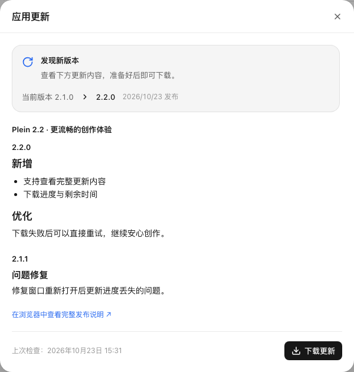
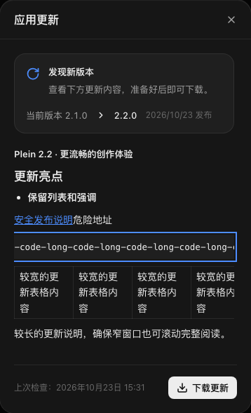

# 桌面更新体验验收（2026-10-23）

更新流程改为自动检查、查看版本说明、主动下载、重启安装。菜单与设置共用应用内更新状态，后台检查不弹系统对话框，下载与完成提示可以收起。长说明单独滚动，更新窗口底部的操作保持可见。

## 实现

- `apps/desktop/src/updater.ts`：检查和下载各自去重，过滤过期结果；`fullChangelog` 获取跨版本说明，`autoDownload=false`，保留正常退出自动安装。下载完成事件缺少说明时沿用检查元数据；检查、下载、同步或异步安装失败均有恢复路径。
- `packages/protocol/src/desktop.ts`、`preload.ts`、`main.ts`：完整状态快照与检查、下载、安装接口；更新操作仅接受当前主窗口的 main frame。页面挂载前到达的更新菜单命令会保留到订阅时交付。
- `DesktopUpdates.tsx`：版本、发布日期、说明、下载大小、进度、速度和估算剩余时间；设置入口、失败重试、下载完成后的安装入口；初始快照不覆盖更晚的推送。
- `releaseNotes.ts`：Markdown 与 GitHub HTML 兼容；HTML 使用 inert template 解析并按标签白名单重建，剥除源属性和主动内容，仅保留 http(s) 外链；代码和表格可用键盘横向滚动。
- 更新面板按需加载；浏览器版不挂载桌面更新组件。设置移除重复 Escape 监听，统一使用现有 Modal 的层级仲裁。

## 验证

| 检查                                                            | 结果                                                    |
| --------------------------------------------------------------- | ------------------------------------------------------- |
| updater、preload、release notes 定向单测                        | 3 个文件，21 项通过                                     |
| `tsc -p apps/web`、`tsc -p apps/desktop`、`tsc -p .`            | 通过                                                    |
| 本次 14 个 TypeScript 文件与 1 个 preload 合同脚本的 `vp check` | 格式与 lint 通过                                        |
| E2E 模式前端构建                                                | 通过                                                    |
| 首页静态依赖 gzip                                               | 273.59 KiB，低于 300 KiB 门禁                           |
| `e2e/desktop-updates.spec.ts`                                   | 6 项通过，7.9 秒                                        |
| Electron 44.8.0 原生文本编辑合同                                | 菜单、主进程和 renderer 的替换／追加撤销重做共 6 项通过 |
| `git diff --check`                                              | 通过                                                    |

浏览器验收运行真实前端与独立临时 Mock 服务，**Electron bridge 与更新源事件使用受控替身**。覆盖主动下载、无说明、跨版本说明、未知总大小、进度与剩余时间、下载失败重试、提示收起、刷新恢复、已下载后的安装按钮、设置入口、检查错误、禁更新、初次读取失败、快照竞态、早到菜单命令、Escape 层级、深色窄窗口，以及 HTML 主动内容过滤和长代码／宽表的键盘滚动。没有实际重启安装，也没有下载真实安装包。

`edit-history-preload.cjs` 的受控桌面桥也同步新接口，并在隐藏的独立 Electron 窗口中运行既有原生文本合同，确认菜单分流和应用挂载未破坏编辑历史。[原生回归结果](../benchmarks/2026-10-23-desktop-update-native-history.json)只证明文本编辑兼容，不证明更新安装链路。

2026-10-23 另通过 GitHub connector 只读核对[最新公开 Release](https://github.com/hoobnn/plein/releases/tag/v0.3.1)：版本 `v0.3.1`，发布说明非空，存在 `latest-mac.yml`。这只确认真实发布源存在，不代替已签名安装包的下载、Squirrel 校验与安装验收。

首次浏览器启动受到 sandbox 的 `tsx` IPC `listen EPERM` 限制；同一独立实例在允许启动浏览器和本地服务后通过。HTML 用例首次断言把相邻链接后的普通文本当作独立精确元素，修正为检查说明区域包含该文本后通过；产品仍保持危险链接不可点击。

本轮没有安装或同步依赖、操作生产数据、替换已安装应用或发版。实现改动留在当前工作树，未提交。

## 界面样例

图标复核后，将发现新版本的星光图标改为环形更新箭头，状态图标缩至 20px；两条浅色与深色窄窗口浏览器用例重新通过，截图已同步。

以下版本和更新内容为受控测试数据，不表示实际发布版本。

