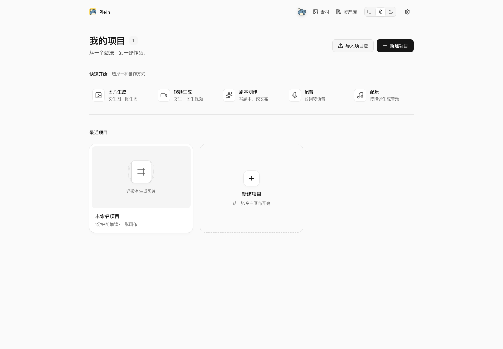
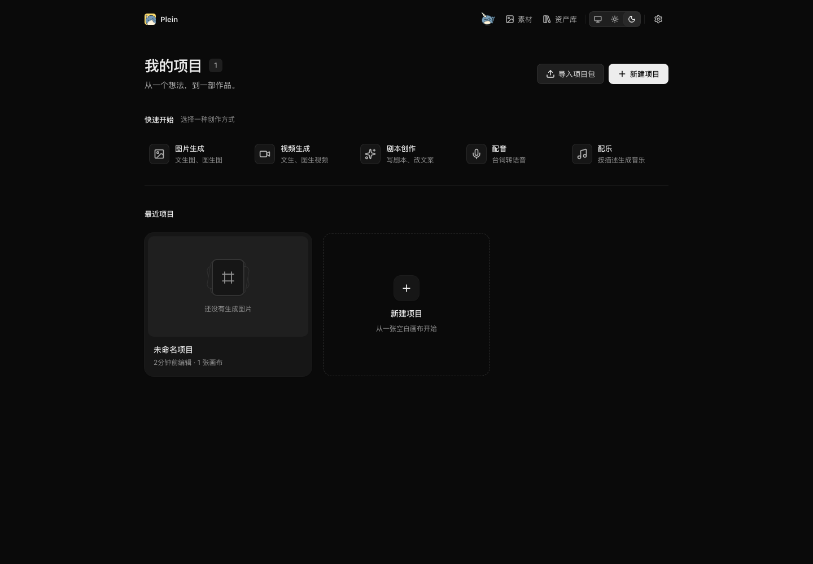
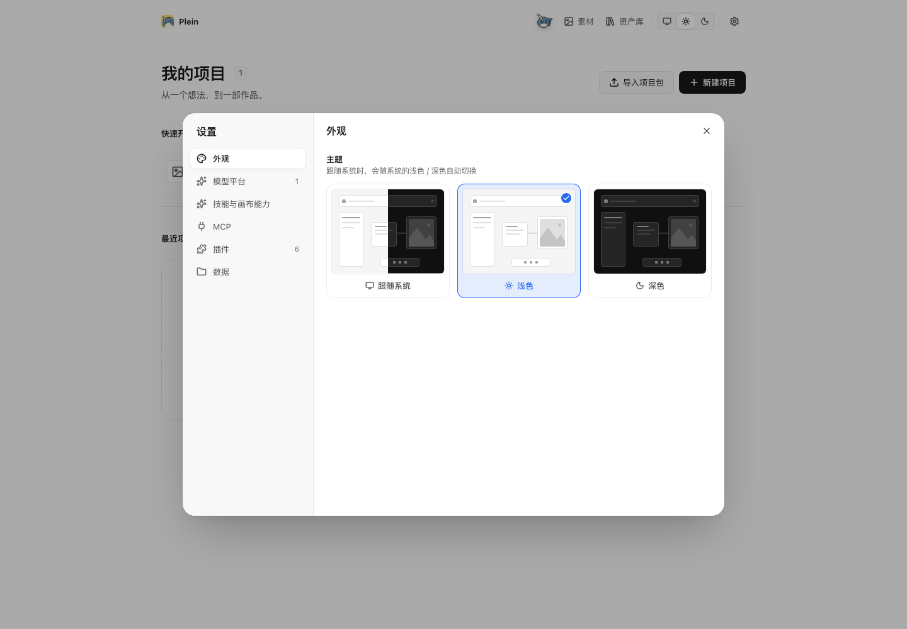
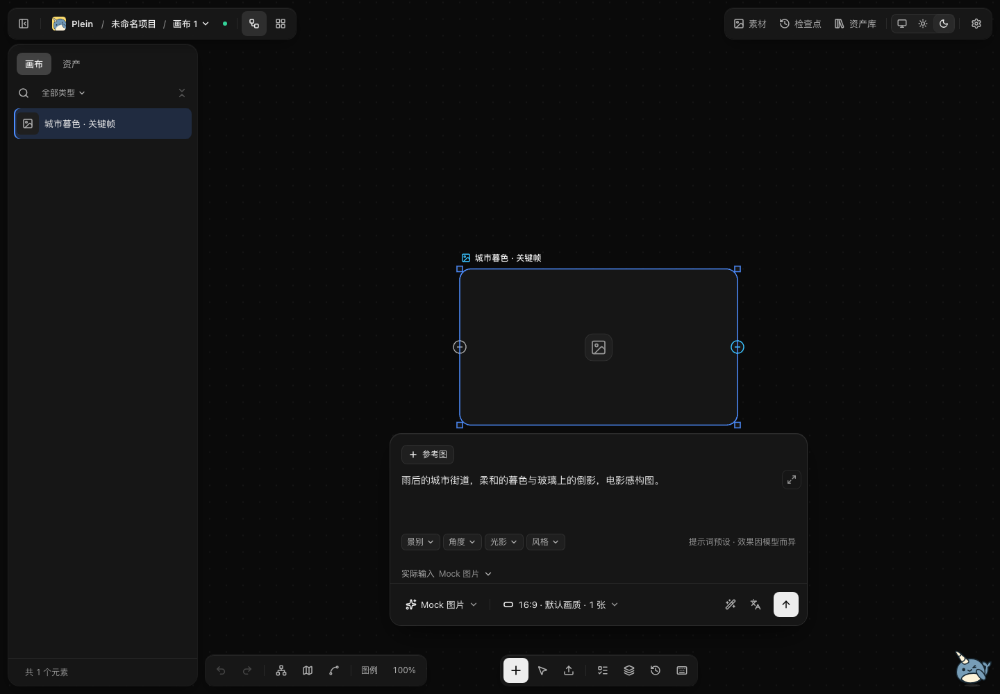
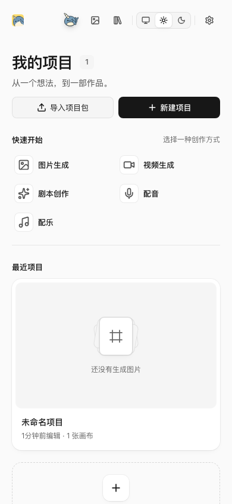
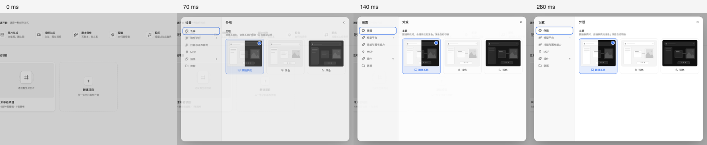

# 视觉系统与交互连续性验收

日期：2026-10-24。

本轮阅读并吸收[《使用 AI 制作交互动画的建议》](https://wxad.design/abc/interactive-design-in-ai)，沿用 Plein 的灰阶外壳和作品优先原则。采用的重点是：切换保留空间关系与稳定元素；动画服务于状态理解；输入与拖动即时跟手；通过实际中间帧复核细节。没有将文章中的营销页面动效直接移植到编辑器。

## 已落地

| 范围         | 实际变化                                                                                                                                         |
| ------------ | ------------------------------------------------------------------------------------------------------------------------------------------------ |
| 首页         | 明确快速开始与最近项目分区；快捷入口使用轻材质；项目封面增大，真实项目在前、新建占位在后；搜索归入项目区；补齐加载状态、按下、键盘焦点和触屏反馈 |
| 明暗主题     | 提升辅助文字对比度；`ink-subtle` 在四级常用背景上均达到 4.5:1；GPU 元素名称与 CSS `ink-muted` 同步                                               |
| 工具条与浮层 | 小工具条保留轻透材质，降低透底干扰；按钮提供轻微按下反馈；提示气泡从实际锚点方向出现；对话框缩放从 96% 收敛至 98.5%                              |
| 外观设置     | 三张 CSS/DOM 编辑器预览卡表示浅色、深色和跟随系统；选中描边与勾标清晰；保持原容器和选中滑块                                                      |
| 节点与生成器 | 生成器使用实底阅读材质，正文与底栏分层；提示词放大按钮不遮挡正文；节点空态、候选导航、按下与禁用反馈统一                                         |
| 连续切换     | 新转场释放旧共享元素名称，旧完成回调不清除新标记；修复快速返回当前工作流时丢失最后一次选择的问题                                                 |
| 布局重排     | 滑块遇到窗口或选项尺寸变化时即时对齐，选择切换仍保留动画；排除滑块自身的尺寸观察，避免观察循环                                                   |
| 减少动态效果 | 最后加载的统一样式覆盖具体组件时长、延迟和循环；保留画布定位 `transform`；首页悬停位移、小满眼睛跟随停用；进度状态继续可见                       |

详细约束已同步至[界面设计规范](design-spec.md)。

## 验证

环境为独立临时数据、真实前端和本地 Mock 平台。没有付费生成请求，也未操作用户的实际项目。

- 转场与画布 store 定向单测：2 个文件，9 项通过，包括真实 `switchMode` 调用链的快速反向选择。
- 浏览器回归覆盖 63 个不同用例；首轮 61 项通过，修复后分组复验。最终固定构建产物的 14 项浮层、顶栏、侧栏、主题与动态效果用例全部通过。
- 覆盖项目创建、改名、失败恢复、搜索、导入导出、侧栏键盘与缩放、生成器长正文、窄窗口、嵌套弹层和焦点归还。宽度覆盖 320、390、639、660、1000、1024、1440px 的相关场景。
- `tsc -p apps/web`、`tsc -p packages/canvas-core`、`tsc -p .` 通过。
- E2E 前端和生产前端构建通过；首页初始 JavaScript gzip 为 **275.46 KiB**，低于 300 KiB 门禁。构建仍提示部分编辑器 chunk 超过 500 kB，此轮未改动其拆包架构。
- 本次源文件、测试和文档格式 / lint 检查及 `git diff --check` 通过。
- 主 Agent 检查明暗主题首页、生成器、设置与窄屏截图；独立 Agent 复核主题卡片在 320 / 390 / 660px 的可读性与可达性。截图采集未出现运行时异常。

新增对比度检查最初未兼容生产 CSS 的三位十六进制缩写，修正颜色解析后通过。窄窗口检查则定位到真实的滑块重排过渡，已修复产品代码。一次复验期间重新构建 E2E 目录，导致旧页面请求已替换的动态 chunk；trace 明确记录 `Failed to fetch dynamically imported module`，固定构建产物后重新验证通过。

这组证据证明本地视觉与相关交互回归，不代替 Electron 安装包、Windows 原生窗口、真实付费平台或所有业务功能的完整验收。CSS 动态效果验证不表示全部 GPU 或媒体动画已经停止；它们继续使用对应模块的既有策略。

## 实际界面

截图中的项目和节点来自隔离的 Mock 环境，空封面保持为空态。

## 动画中间帧

对实际 `ui-pop-in` CSS 动画在首帧前暂停，再将 `Animation.currentTime` 分别设为 0、70、140、280ms 采样。未额外合成动画；拼图仅用于并排检查。透明度依次为 0、0.765、0.961、1，缩放从 0.985 收敛至 1，纵向位移从 6px 收敛至 0。没有内容重排或容器更换。

[采样数据](../benchmarks/2026-10-24-visual/dialog-frames.json)与[截图运行记录](../benchmarks/2026-10-24-visual/capture.json)保留在仓库中。

本文记录本地验收结果；正式发版状态以 GitHub Release 和对应工作流为准。
