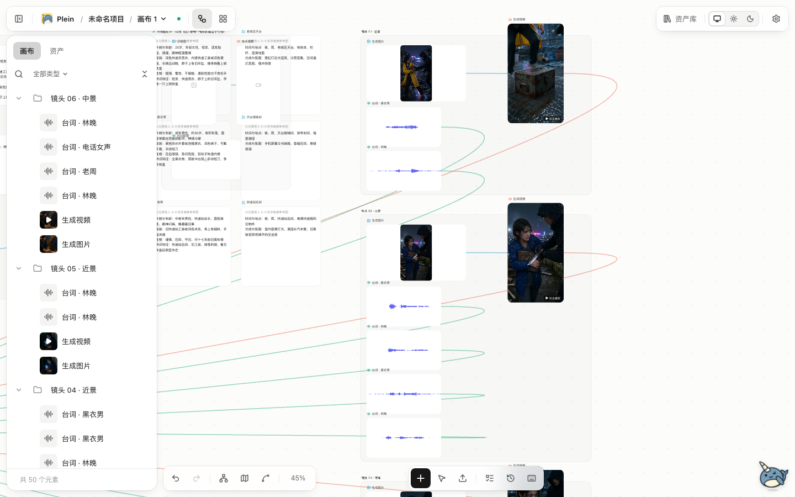
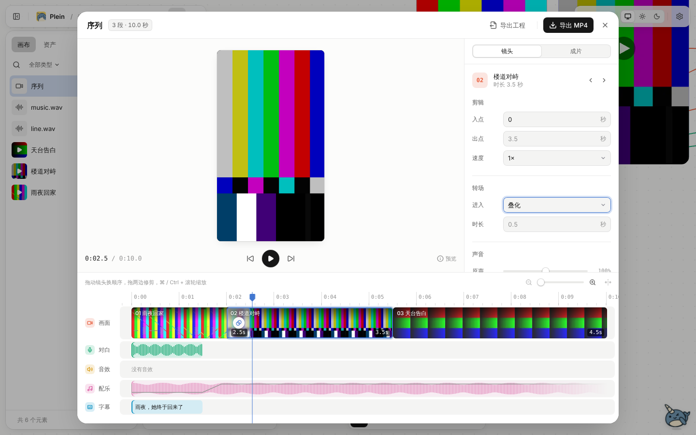

# 做出第一条短剧

这篇带你从安装开始，用十步做出一条能导出的 MP4。会花钱的地方都标出来了。第一次建议只做一两个镜头，确认效果再放量。

## 先了解三个词

- **节点**：画布上的一张卡片，每张卡片负责一件事，比如写剧本、画一张图、配一句音。
- **连线**：卡片之间的线。上游的结果会送给下游用。
- **模型平台**：真正生成内容的服务，比如火山方舟、阿里云百炼。Plein 本身不生成，用的是你自己的平台账号，费用由平台按用量收。

## 1. 安装

macOS（Apple 芯片）到 [Releases](https://github.com/hoobnn/plein/releases/latest) 下载 `.dmg`，拖进「应用程序」打开。其他系统用 Docker 自部署，见 [README](../../README.md#快速开始)。

## 2. 配一个平台密钥

第一次打开会出现新手引导，按提示连接模型平台即可。之后想改，在设置里的「模型平台」。引导可以随时从 ⌘K 的「打开新手引导」或设置里重新打开。

1. 选一家平台（各家能做什么见[模型平台接入](providers.md)）。完整的短剧要图片、视频、配音都有，只配一家可能做不全，可以先配文本和图片，之后再补。
2. 去该平台的控制台申请 API 密钥，粘贴到对应输入框，保存并启用。
3. 在「默认模型」里确认每种能力用哪个模型。

会看到什么：保存后密钥只显示掩码。百炼、豆包语音的连接测试只检查有没有填，状态是「已填写，未验证」，到第一次生成时才会真正验证。所以密钥填错的话，要到第一次生成才会报错。

常见卡点：

- 生成时提示认证失败：回到设置，点密钥旁的「更换」重新粘贴，注意前后不要带空格，地域要和密钥对应（MiniMax 国内和国际的密钥不通用）。
- 节点里选不到想用的模型：平台没启用，或者该模型没有在平台控制台开通。去平台控制台确认。

## 3. 新建项目

在首页新建一个项目。一个项目对应一部作品，里面可以有多张画布。

## 4. 点「短剧模板」

新画布是空的，中间有几张起点卡。点第一张「短剧模板」。想让助手代劳，可以点「让小满帮我搭」。

会看到什么：画布上铺出一整条流程，从创意、剧本、角色与场景、分镜到序列。插入模板只搭骨架，不会调用模型，也不花钱。同时会自动打开「创作下一步」，并定位到第一个要运行的节点。

## 5. 写创意

在第一个节点里写下你的故事想法。几句话就够，说清题材、主角、冲突和想要的结尾。

## 6. 跑剧本和分镜

按「创作下一步」的提示，依次运行：

1. 「文本生成」节点写出剧本。
2. 角色与场景抽取出设定卡。
3. 分镜节点生成分镜表。

每个节点点「运行」即可。文本生成通常费用很低。

会看到什么：分镜表按镜头列出景别、画面、台词。可以直接在表里改，改完再往下走。点「我已人工核对这份分镜」可以记一笔你看过了。

常见卡点：

- 运行后节点标红或任务失败：打开任务面板看原因。多数是密钥或模型未启用，回到第 2 步检查。
- 想改剧本又怕下游白做：改完点「查看影响」，只重做勾选的节点，其余结果保留。

## 7. 先试做一个镜头

不要一上来整部生成。在分镜表点「展开为镜头」，把每一行变成独立的镜头节点，然后只挑一个有代表性的镜头：

1. 生成这个镜头的分镜图。图片通常比视频便宜很多。
2. 满意后生成视频。**视频是最贵的环节**，第一次先只做这一个。
3. 给这个镜头生成配音。

生成前可以打开「实际输入」预览，看清楚送给模型的提示词和参考图。每次生成都会留下候选，下游只用你采用的那一版，不满意就换一个或重新生成。

会看到什么：镜头节点上出现图片、视频和音频，任务面板显示进度。视频一般要等几分钟。

常见卡点：

- 任务失败：任务面板会写原因。网络问题可以直接重试。
- 状态显示不确定，比如提示「平台暂时没回结果」：这表示平台可能已经收到请求，直接重新提交可能重复扣费。能自动核查的平台会有「再查一次」按钮，先点它让 Plein 去平台问问结果；没有这个按钮时（多数内置平台不支持自动核查），到「高级选项」里处理，例如手填平台控制台里查到的任务 ID。
- 画面里角色不像：在提示词里用 `@` 引用角色档案，并给角色放上参考图，见[角色档案](characters.md)。

## 8. 批量生成

试做的结果满意后，回到分镜表，用「批量出分镜图」「批量生成视频」「批量配音」。点击后先出一张清单，列出这次会生成哪些、哪些沿用、哪些被挡住以及原因。确认后才开始。

建议分批：先批量出全部分镜图，看过没问题，再批量出视频，最后配音。每一批都先核对清单里的数量。

清单里的调用次数是预计次数，不等于实际扣费。没改动的镜头不会重复生成，失败的镜头可以单独重试。

## 9. 在序列里排好

镜头都有了以后，打开「序列」节点，也就是剪辑时间线。

- 拖动镜头调整顺序，调入点和出点来裁剪。
- 检查每段的对白、音效和字幕。字幕可以逐句改文字和时间。
- 可以加配乐、设置转场。

> 上图使用的是测试素材，不是真实成片。

会看到什么：时间线上有画面、对白、音效、配乐、字幕几条轨，可以直接预览。

如果只想先看节奏，可以在分镜表的「更多分镜操作」里点「节奏样片」，用分镜图和已有配音拼一个草稿，不会调用任何模型。

## 10. 导出 MP4

在序列编辑器点「导出 MP4」，选画幅（竖屏 9:16 或横屏 16:9）和清晰度（1080p 或 720p）。导出在本机完成，不收平台费用。

导出成功后进入「实际 MP4 回看」，播放真正导出的文件，在需要修改的时间点加意见，全部解决后再确认交付。想拿到剪辑软件里继续做，用「导出工程」。

常见卡点：

- 导出失败：展开「查看错误详情」读原因。多数是某个镜头缺素材或缺时长，补齐后重新导出。
- 字幕不显示或乱码：桌面版自带字体；自部署时确认服务器装了中文字体。

## 之后

- 想了解审片、验收、返工和交付的细节，看[进阶参考：从样片到交付](creation-workflow.md)。
- 提示词写法、候选对比和素材复用，看[创作、审片与复用](creation-review.md)。
- 数据备份和恢复，看[本机数据维护](data-maintenance.md)。
