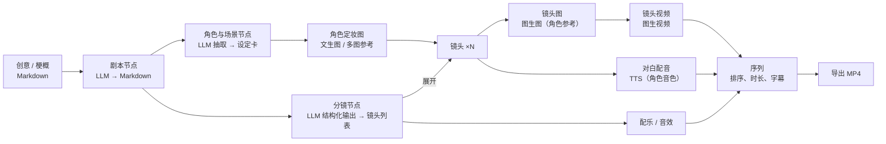

# plein 0.1.0 规划：本地自部署的 AI 短剧画布

2026-10-11 · hoobnn

## 一句话目标

`docker compose up`（或 `pnpm start`）后在本机浏览器打开 plein，导入图片、视频、音频、Markdown 素材，接入火山方舟、豆包语音、阿里云百炼、MiniMax 的文本 / 图像 / 视频 / 音频模型，在画布上把“创意 → 剧本 → 角色 → 分镜 → 镜头图 → 镜头视频 → 配音配乐 → 成片”这条 AI 短剧流水线跑通，并导出一个带字幕的 MP4。

## 0.1.0 不做

多人协作与账号、云端托管与计费、对象存储、HLS、subdocs、OffscreenCanvas、第三方节点开放、移动端、10 万元素级性能目标。这些仍按 [architecture.md](architecture.md) 的阶段三、四推进。

---

## 一、技术选型评估

结论：前端选型合理，保留；后端和存储需要为“本地自部署”收窄，原规划里面向云端多租户的部分（Postgres、S3、独立 sync 服务、Bun）推迟到托管版。

| 选型 | 结论 | 说明 |
| --- | --- | --- |
| pnpm monorepo + TS | 保留 | 包边界（doc / canvas-core / flow）与前后端共享代码的需求吻合 |
| React 19 + Vite 8 + Tailwind v4 + zustand | 保留 | 外壳、面板、表单用 React；热路径已在 canvas-core 内，不受 React 影响 |
| PixiJS v8 画布 | 保留，默认 WebGL2 | 图片、视频帧、缩略图走 GPU 合适。0.1.0 默认 `preference: 'webgl'`，WebGPU 作为可选项，等有基准和兼容性数据再切默认（推断：WebGPU 在 Safari / 部分驱动上仍有差异，未实测） |
| Yjs 文档 | 保留 | 单人本地也受益：撤销、多标签页同步、离线、以后接协作不改模型。必须先完成“每元素一个嵌套 `Y.Map`”改造 |
| Markdown 编辑 | 选 CodeMirror 6 + `y-codemirror.next` | Markdown 源码即事实，比 Tiptap/Lexical 轻；展示用 markdown-it + DOMPurify。关闭 architecture.md 里“富文本编辑器”这一待定项 |
| 参数 schema | zod v4 | 同时驱动校验、表单渲染和 LLM 结构化输出（JSON Schema 导出） |
| 后端运行时 Bun | 改为 Node（与仓库一致） | 仓库工具链已锁 Node 26 + pnpm，再引入 Bun 等于两套运行时、两套原生模块。Hono 在 Node 上同样可用（`@hono/node-server`、`@hono/node-ws`），以后要换 Bun 只换入口 |
| Postgres + MinIO/S3 | 改为 SQLite + 本地文件系统 | 本地单用户不需要数据库服务。SQLite（better-sqlite3 + Drizzle；`node:sqlite` 稳定后可替换）存元数据、Yjs 更新、任务队列；资产按内容哈希存 `data/assets/` |
| 任务队列 | SQLite 表 + 进程内 worker | 取代 `SKIP LOCKED`，无 Redis。重启后从表里恢复未完成的远端任务继续轮询 |
| 媒体处理 libvips + ffmpeg | 保留，换成 sharp + 系统 ffmpeg | sharp 自带 libvips；ffmpeg/ffprobe 负责元数据、封面、波形图、拼接、混音、烧字幕。Docker 镜像内置，裸跑要求本机已装 |
| 模型接入 | 新建 TS 包 `packages/providers`，以 hoobnn-mcps 为契约参考 | 不在运行时调用 Python MCP：多一套 Python 运行时、工具级接口不带类型、结果是本地路径。hoobnn-mcps 已验证过各家端点、异步任务和交付细节，按它移植 TS 适配器；以后可加一个通用“MCP 工具节点”作为扩展口 |
| TypeScript 7 | 保留，注意工具链 | TS 7 原生编译器的程序化 API 与 5.x 不同，依赖 TS API 的工具（typescript-eslint 类型感知规则等）可能跟不上（推断，未逐个验证）。lint 选 Biome 或 oxlint，测试用 Vitest（自带转译，不依赖 tsc） |
| 部署 | Docker Compose 单容器 + `pnpm start` | 一个 Node 进程同时提供静态前端、API、WebSocket、worker；数据全在一个 `data/` 目录，备份即拷目录。桌面壳（Tauri）留到以后 |

### 对 architecture.md 原则的两处调整

1. **“服务端可选”在 0.1.0 改为“本地服务端必需”**。原因：模型密钥不能进浏览器、各家接口不支持浏览器跨域、长任务需要在关页面后继续跑、生成结果的临时 URL 一般 24 小时失效，必须由服务端落盘。前端仍不直接依赖 Postgres/S3 一类云服务。
2. **文档持久化以服务端为准**。浏览器 IndexedDB 只做离线缓存；画布文档通过 y-websocket 协议同步到本地服务端，存 SQLite。否则文档在浏览器、素材在服务端，清浏览器数据就会“素材还在、画布没了”。

### 本地部署带来的接入约束

| 约束 | 影响 | 0.1.0 处理 |
| --- | --- | --- |
| 本地素材没有公网 URL | 方舟 Seedance 的参考视频 / 音频只收公网 URL 或方舟素材 ID | 图片一律 base64 data URL 传；Seedance 0.1.0 只用图片参考（首帧、首尾帧、多图参考）。需要视频 / 音频参考的走百炼万相（自带临时上传）或 MiniMax（`/v1/files/upload` → `mm_file://`） |
| 结果 URL 会过期 | 方舟、百炼返回的结果链接约 24 小时有效 | 任务完成即下载入资产库，文档只存 `assetId` |
| 音色不能跨平台 | 各家复刻 / 设计的音色只能在同家 TTS 用 | 角色的“声音”绑定为 `{provider, voiceId}`，换平台需重新选 |
| 各家限流与计费不同 | 并发过高会 429，视频按秒计费 | Provider 声明并发上限；执行前在节点上显示预估用量（秒数、张数、字数），不估算金额 |

---

## 二、模型接入矩阵

以 hoobnn-mcps 已对接的端点和模型为准；模型 ID 放在配置里，不写死在节点中。

| 能力 | 火山方舟 | 豆包语音 | 阿里云百炼 | MiniMax |
| --- | --- | --- | --- | --- |
| 文本 / 多模态理解 | `/chat/completions`，Doubao Seed（OpenAI 兼容） | — | `compatible-mode/v1`，qwen3.8 系列及托管的 DeepSeek、Kimi、GLM | OpenAI 兼容对话接口（M 系列，待接入时验证） |
| 图像 | Seedream 5.0 pro / flash / lite（`/images/generations`，多图参考、组图） | — | qwen-image-3.0-pro、wan2.7-image-pro（多参考图）、z-image-turbo | `image-01` / `image-01-live`（`/v1/image_generation`） |
| 视频 | Seedance 2.0 / 2.5（`/contents/generations/tasks` 异步） | — | wan3.0-video（异步任务，带音频，最长 30 秒）、wan2.2-s2v 对口型 | MiniMax H3 / H3-Max（`/v2/video_generation` 异步） |
| 语音合成 | — | seed-tts-2.0（`/api/v3/tts/unidirectional`），复刻 / 设计音色 | qwen3-tts-flash / instruct，复刻 / 设计音色 | speech-2.8-hd（`/v1/t2a_v2`），复刻 / 设计音色 |
| 音效 / 配乐 | — | seed-audio-1.0（音效、配乐、多角色对白，最长 120 秒） | — | music-3.0（`/v1/music_generation`） |
| 语音识别（字幕对齐） | — | 极速版 flash | qwen3-asr-flash | — |

`packages/providers` 的统一接口（示意）：

```ts
interface Provider {
  id: 'ark' | 'doubao-speech' | 'bailian' | 'minimax'
  capabilities: Capability[]          // text.chat, image.generate, video.generate, speech.tts, audio.generate, ...
  limits: { concurrency: Record<Capability, number> }
  submit(cap, input, ctx): Promise<SyncResult | { remoteTaskId: string }>
  poll?(remoteTaskId, ctx): Promise<Pending | Done | Failed>
  cancel?(remoteTaskId, ctx): Promise<void>
}
```

- 输入里的素材用 `assetId`，由适配器决定转成 base64、临时上传还是文件 ID。
- 输出统一为“资产列表 + 原始响应摘要”，worker 下载入库后写回文档。
- 每个适配器配一组录制的请求 / 响应夹具做契约测试，CI 不打真接口；另有一个手动触发的“真机冒烟”脚本，读本地密钥逐家调用最便宜的模型。

---

## 三、AI 短剧流水线

画布上的节点和素材都是普通元素；一条流水线就是一组连好线的节点。0.1.0 提供一个“短剧模板”，一键铺出下面的骨架，用户可以在任意一步替换模型、改参数、手动替换素材。



关键设计：

- **结构化中间产物**：剧本是 Markdown（可直接编辑）；分镜是带 schema 的 JSON（镜头号、景别、画面描述、出场角色、对白、时长），存在节点参数里，也可在表格视图里改。
- **展开（fan-out）**：分镜节点“展开”后，为每个镜头生成一组子节点（镜头图 → 镜头视频、对白 → 配音），按网格自动排布，并用 Frame 分组。重新展开时按镜头号对齐，已手动修改的镜头不覆盖。
- **角色一致性**：角色设定卡持有“定妆图 + 声音 `{provider, voiceId}`”；镜头图节点自动把出场角色的定妆图作为参考图传入（Seedream / wan2.7 / qwen-image 多图参考）。
- **候选与选定**：生成类节点可一次出多张 / 多条，结果铺在节点旁，用户点选“采用”，下游只吃被采用的那个。
- **序列元素**：一个轻量时间线，不是剪辑软件。按镜头顺序排列视频片段，每段可调入出点和时长；音轨三条（对白、配乐、音效），对白自动对齐到所属镜头；字幕由对白文本生成（可选用 ASR 校时间轴）。浏览器内用 DOM `<video>`/`<audio>` 粗预览，导出由服务端 ffmpeg 完成（拼接、转码统一分辨率和帧率、混音、烧录 SRT）。

---

## 四、0.1.0 功能清单

按优先级：P0 是 0.1.0 必须有，P1 争取进入，没做完顺延到 0.2.0。

### A. 画布与文档

| 功能 | 优先级 |
| --- | --- |
| 文档模型改造：每元素嵌套 `Y.Map`、命令式 API、`schemaVersion` 与迁移、z 序（分数索引）、`parentId` 分组 | P0 |
| 元素类型：图片、视频、音频、Markdown、节点、Frame、序列；按类型注册渲染器 | P0 |
| 交互：选择、框选、拖动、缩放变换、删除、复制粘贴、撤销重做、连线、对齐吸附（基础） | P0 |
| 视口裁剪 + rbush 空间索引；1000 元素画布平移流畅 | P0 |
| 素材导入：拖拽 / 粘贴 / 选择文件，多文件批量 | P0 |
| 图片：缩略图级别按缩放切换；视频：封面 + 聚焦时播放（同时播放上限 4）；音频：波形图 + 点击播放；Markdown：放大时 DOM 渲染 / 编辑，缩小时显示纹理快照 | P0 |
| 多画布（项目列表）、重命名、删除 | P0 |
| 小地图、搜索元素 | P1 |

### B. 本地服务端（`services/server`）

| 功能 | 优先级 |
| --- | --- |
| 单进程：Hono（HTTP + WebSocket）+ 静态前端 + 任务 worker | P0 |
| 数据目录 `data/`：`plein.db`（SQLite）、`assets/`、`exports/`、`logs/` | P0 |
| Yjs 文档同步与持久化（y-websocket 协议，更新追加 + 定期合并快照） | P0 |
| 资产：内容哈希、去重、ffprobe 元数据、sharp 缩略图、视频封面、音频波形 | P0 |
| 任务队列：提交、轮询远端、下载入库、取消、失败重试、重启恢复；SSE 推送进度 | P0 |
| 安全默认值：只监听 `127.0.0.1`；监听其他地址时必须设置访问令牌 | P0 |
| 用量记录：按平台 / 能力统计调用次数、秒数、字数 | P1 |

### C. 模型接入（`packages/providers`）

| 功能 | 优先级 |
| --- | --- |
| 设置页：四家平台的密钥、地域 / Base URL、启用开关、“测试连接”；密钥存 `data/` 下的独立文件（权限 600），不进文档和日志 | P0 |
| 文本：方舟、百炼、MiniMax 的对话 + 结构化输出（JSON Schema） | P0 |
| 图像：方舟 Seedream、百炼 qwen-image / wan2.7、MiniMax image-01；文生图、多参考图生图 | P0 |
| 视频：方舟 Seedance、百炼 wan3.0、MiniMax H3；文生、首帧、首尾帧 | P0 |
| 语音合成：豆包 seed-tts-2.0、百炼 qwen3-tts、MiniMax speech-2.8-hd；系统音色列表与试听 | P0 |
| 音效 / 配乐：豆包 seed-audio-1.0、MiniMax music-3.0 | P0 |
| 声音复刻 / 设计（三家） | P1 |
| 对口型：百炼 wan2.2-s2v | P1 |
| 语音识别校字幕：豆包 flash / 百炼 qwen3-asr | P1 |
| 契约测试夹具 + 真机冒烟脚本 | P0 |

### D. 工作流（`packages/flow`）

| 功能 | 优先级 |
| --- | --- |
| 节点定义：类型、版本、zod 参数 schema、端口类型（text / image / video / audio / json）、`execute` | P0 |
| 节点表单由 schema 自动生成；模型下拉框只列已启用平台支持该能力的模型 | P0 |
| 运行：单节点、运行到此处（含上游）、运行下游；拓扑并发，按平台限流 | P0 |
| 缓存：类型@版本 + 规范化参数 + 输入哈希 + 模型；未改动的节点不重跑 | P0 |
| 状态：排队 / 运行 / 成功 / 失败 / 已取消，节点上显示进度和错误原因 | P0 |
| 多候选输出与“采用” | P0 |
| 提示词模板变量（`{{角色.外貌}}`、`{{镜头.画面}}`） | P1 |

首批节点：文本（Prompt）、LLM、文生图、图生图、图生视频、TTS、音效、配乐、剧本、角色抽取、分镜、序列导出。

### E. 短剧功能

| 功能 | 优先级 |
| --- | --- |
| 短剧模板：一键铺出第三节的节点骨架，内置中文提示词（可改） | P0 |
| 分镜展开、重新展开时保留手改 | P0 |
| 角色设定卡：定妆图 + 声音绑定，镜头自动引用 | P0 |
| 序列元素与 ffmpeg 导出 MP4（1080p / 720p，9:16 与 16:9），烧录字幕 | P0 |
| 分镜表格视图（批量改画面描述、时长、对白） | P1 |
| 批量操作：选中多个镜头一起生成 / 重试 | P1 |

### F. 工程

| 功能 | 优先级 |
| --- | --- |
| Vitest：doc（含双文档并发、迁移）、flow（编译、缓存、调度）、providers（夹具）、server（mock Provider 集成） | P0 |
| Playwright：导入素材、跑通 mock 短剧模板、导出的冒烟测试 | P0 |
| Biome（或 oxlint）lint + format，进 CI | P0 |
| Dockerfile（含 ffmpeg）+ `compose.yaml`；README 写清本地运行步骤 | P0 |
| 性能基准（1000 / 1 万元素平移帧率）进 CI | P1 |

---

## 五、里程碑

顺序推进，每个里程碑结束时 main 可运行。只列门槛，不承诺时间。

| 里程碑 | 内容 | 完成门槛 |
| --- | --- | --- |
| M1 地基 | doc 模型改造、命令式 API；按类型渲染、裁剪、选择 / 变换；lint + Vitest | 1000 元素画布可编辑，撤销重做正确，测试进 CI |
| M2 本地服务与素材 | `services/server`、SQLite、Yjs 持久化、资产上传与衍生物；四类素材元素完整可用；Docker | `docker compose up` 后导入图片 / 视频 / 音频 / Markdown，刷新和重启后都不丢 |
| M3 模型与工作流 | `packages/providers` 四家适配器、设置页；`packages/flow`、任务队列、SSE；基础节点 | 提示词 → 图片 → 视频 → 配音在画布上端到端跑通，四家每类能力至少一个模型冒烟通过，未改动节点命中缓存 |
| M4 短剧流水线 | 剧本、角色、分镜节点，展开，角色一致性，序列与导出 | 从一句创意出发，用模板生成 6–10 个镜头、配音配乐，导出带字幕的 MP4 |
| M5 打磨发布 | P1 选做项、错误提示、空状态、文档、Playwright 冒烟 | 新机器按 README 十分钟内跑起来，打 `v0.1.0` 标签 |

## 六、需要你拍板的事

| 问题 | 默认（未回复即按此执行） |
| --- | --- |
| 后端运行时：Node 还是 Bun | Node，与仓库一致 |
| 存储：SQLite + 本地目录，Postgres/S3 推迟到托管版 | 是 |
| 默认渲染后端：0.1.0 先 WebGL2 | 是 |
| 模型接入：在 TS 中移植适配器，不在运行时调用 hoobnn-mcps | 是 |
| 默认平台组合（模板里预选的模型） | 文本：方舟 Doubao Seed；图像：方舟 Seedream 5.0 pro；视频：方舟 Seedance 2.0；配音：豆包 seed-tts-2.0；配乐：MiniMax music-3.0 |
| 文档持久化以服务端 SQLite 为准，IndexedDB 只做缓存 | 是 |
