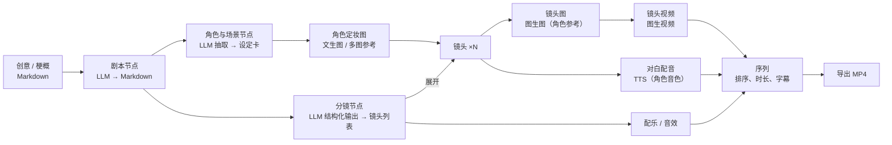

# plein 0.1.0 规划：本地自部署的 AI 短剧画布

2026-10-11 · hoobnn

## 一句话目标

`docker compose up`（或 `pnpm start`）后在本机浏览器打开 plein，导入图片、视频、音频、Markdown 素材，接入火山方舟、豆包语音（P0）以及阿里云百炼、MiniMax（P1）的文本 / 图像 / 视频 / 音频模型，在画布上把“创意 → 剧本 → 角色 → 分镜 → 镜头图 → 镜头视频 → 配音配乐 → 成片”这条 AI 短剧流水线跑通，并导出一个带字幕的 MP4。

## 0.1.0 不做

多人协作与账号、云端托管与计费、对象存储、HLS、subdocs、OffscreenCanvas、第三方节点开放、移动端、10 万元素级性能目标。这些仍按 [architecture.md](architecture.md) 的阶段三、四推进。

---

## 一、技术选型评估

结论：前端选型合理，保留；后端和存储需要为“本地自部署”收窄，原规划里面向云端多租户的部分（Postgres、S3、独立 sync 服务）推迟到托管版，后端运行时由 Bun 改为 Node。

| 选型                                      | 结论                                                       | 说明                                                                                                                                                                                                                                      |
| ----------------------------------------- | ---------------------------------------------------------- | ----------------------------------------------------------------------------------------------------------------------------------------------------------------------------------------------------------------------------------------- |
| pnpm monorepo + TS                        | 保留                                                       | 包边界（doc / canvas-core / flow）与前后端共享代码的需求吻合                                                                                                                                                                              |
| React 19 + Vite 8 + Tailwind v4 + zustand | 保留                                                       | 外壳、面板、表单用 React；热路径已在 canvas-core 内，不受 React 影响                                                                                                                                                                      |
| PixiJS v8 画布                            | 保留，默认 WebGL2                                          | 图片、视频帧、缩略图走 GPU 合适。0.1.0 默认 `preference: 'webgl'`，WebGPU 作为可选项，等有基准和兼容性数据再切默认（推断：WebGPU 在 Safari / 部分驱动上仍有差异，未实测）                                                                 |
| Yjs 文档                                  | 保留                                                       | 单人本地也受益：撤销、多标签页同步、离线、以后接协作不改模型。必须先完成“每元素一个嵌套 `Y.Map`”改造                                                                                                                                      |
| Markdown 编辑                             | 选 CodeMirror 6 + `y-codemirror.next`                      | Markdown 源码即事实，比 Tiptap/Lexical 轻；展示用 markdown-it + DOMPurify。关闭 architecture.md 里“富文本编辑器”这一待定项                                                                                                                |
| 参数 schema                               | zod v4                                                     | 同时驱动校验、表单渲染和 LLM 结构化输出（JSON Schema 导出）                                                                                                                                                                               |
| 后端运行时 Bun                            | 改为 Node（已确认）                                        | 仓库工具链已锁 Node 26 + pnpm，统一一套运行时、一套原生模块。Hono 在 Node 上同样可用（`@hono/node-server` 自带 WebSocket 升级，配合 `ws`），以后要换 Bun 只换入口                                                                         |
| 服务端运行 TS 源码                        | 开发 `tsx watch`，发布打包                                 | workspace 包 `exports` 直接指向 `src/*.ts` 且导入不带扩展名，Node 自带的类型剥离跑不起来。开发用 tsx；发布和 Docker 用 tsdown（或 esbuild）把服务端连同 workspace 包打成一个 `dist/`，各包保持源码直出                                    |
| 包边界                                    | 节点声明与执行分开，新增 protocol 包                       | 节点的参数 schema、端口、模板提示词前后端共用；`execute` 要调供应商、读密钥、用 ffmpeg，只能在服务端。两者分开，前端打包不会带进服务端代码。前后端接口（上传、任务、SSE、设置）的 zod schema 放 `packages/protocol`。目录见下方“目录结构” |
| Postgres + MinIO/S3                       | 改为 SQLite + 本地文件系统                                 | 本地单用户不需要数据库服务。SQLite（better-sqlite3 + 手写 SQL，`PRAGMA user_version` 做迁移；表少，暂不引入 ORM；`node:sqlite` 稳定后可替换）存元数据、Yjs 更新、任务队列；资产按内容哈希存 `data/assets/`                                |
| 任务队列                                  | SQLite 表 + 进程内 worker                                  | 取代 `SKIP LOCKED`，无 Redis。重启后从表里恢复未完成的远端任务继续轮询                                                                                                                                                                    |
| 媒体处理 libvips + ffmpeg                 | 保留，换成 sharp + 系统 ffmpeg                             | sharp 自带 libvips；ffmpeg/ffprobe 负责元数据、封面、波形图、拼接、混音、烧字幕。Docker 镜像内置，裸跑要求本机已装                                                                                                                        |
| 模型接入                                  | 新建 TS 包 `packages/providers`，以 hoobnn-mcps 为契约参考 | 不在运行时调用 Python MCP：多一套 Python 运行时、工具级接口不带类型、结果是本地路径。hoobnn-mcps 已验证过各家端点、异步任务和交付细节，按它移植 TS 适配器；以后可加一个通用“MCP 工具节点”作为扩展口                                       |
| TypeScript 7                              | 保留，注意工具链                                           | TS 7 原生编译器的程序化 API 与 5.x 不同，依赖 TS API 的工具（typescript-eslint 类型感知规则等）可能跟不上（推断，未逐个验证）。lint 选 Biome 或 oxlint，测试用 Vitest（自带转译，不依赖 tsc）                                             |
| 部署                                      | Docker Compose 单容器 + `pnpm start`                       | 一个 Node 进程同时提供静态前端、API、WebSocket、worker；数据全在一个 `data/` 目录，备份即拷目录。桌面壳（Tauri）留到以后                                                                                                                  |

### 目录结构（已确认）

```text
apps/
  web/                 前端
  server/              本地服务：Hono + y-websocket + 资产 + 任务 worker + 静态前端
    src/http/ sync/ assets/ jobs/ export/ storage/ executors/ auth/ plugins/
packages/
  doc/                 Yjs 文档模型、命令式 API
  canvas-core/         渲染与交互（不直接依赖 yjs，只消费 doc 给出的快照与变更事件）
  protocol/            前后端共享的 HTTP / SSE / WS 消息 zod schema 与类型
  flow/                工作流引擎：编译、缓存键、调度（不依赖供应商）
  nodes/               内置节点声明：参数 schema、端口、迁移、短剧模板与提示词（前后端共用）
  providers/           平台适配器，仅服务端 + fixtures/<provider>/
  plugin-sdk/          插件公开 API：清单 schema、defineNode / defineProvider 等类型与辅助函数
e2e/                   Playwright
scripts/               真机冒烟、基准等脚本
Dockerfile · compose.yaml · .dockerignore · biome.json · vitest.config.ts
```

- 节点执行器放 `apps/server/src/executors/`，按 `type@version` 注册到 flow；`apps/web` 不依赖 `providers`，平台能力和模型列表通过 `protocol` 接口从服务端获取。
- 单测与源码同目录（`src/**/*.test.ts`），根目录 `vitest.config.ts` 用 projects 汇总。
- 数据目录默认 `./data`，可用 `PLEIN_DATA_DIR` 覆盖，Docker 挂卷到此路径。

### 对 architecture.md 原则的两处调整

1. **“服务端可选”在 0.1.0 改为“本地服务端必需”**。原因：模型密钥不能进浏览器、各家接口不支持浏览器跨域、长任务需要在关页面后继续跑、生成结果的临时 URL 一般 24 小时失效，必须由服务端落盘。前端仍不直接依赖 Postgres/S3 一类云服务。
2. **文档持久化以服务端为准**。浏览器 IndexedDB 只做离线缓存；画布文档通过 y-websocket 协议同步到本地服务端，存 SQLite。否则文档在浏览器、素材在服务端，清浏览器数据就会“素材还在、画布没了”。

### 本地部署带来的接入约束

| 约束                 | 影响                                                      | 0.1.0 处理                                                                                                                                                                             |
| -------------------- | --------------------------------------------------------- | -------------------------------------------------------------------------------------------------------------------------------------------------------------------------------------- |
| 本地素材没有公网 URL | 方舟 Seedance 的参考视频 / 音频只收公网 URL 或方舟素材 ID | 图片一律 base64 data URL 传；Seedance 在 P0 只用图片参考（首帧、首尾帧、多图参考）。视频 / 音频参考随 P1 的百炼万相（自带临时上传）或 MiniMax（`/v1/files/upload` → `mm_file://`）提供 |
| 结果 URL 会过期      | 方舟、百炼返回的结果链接约 24 小时有效                    | 任务完成即下载入资产库，文档只存 `assetId`                                                                                                                                             |
| 音色不能跨平台       | 各家复刻 / 设计的音色只能在同家 TTS 用                    | 角色的“声音”绑定为 `{provider, voiceId}`，换平台需重新选                                                                                                                               |
| 各家限流与计费不同   | 并发过高会 429，视频按秒计费                              | Provider 声明并发上限；执行前在节点上显示预估用量（秒数、张数、字数），不估算金额                                                                                                      |

---

## 二、模型接入矩阵

以 hoobnn-mcps 已对接的端点和模型为准；模型 ID 放在配置里，不写死在节点中。火山方舟和豆包语音是 P0，短剧流水线只靠这两家就能跑通；阿里云百炼和 MiniMax 是 P1，接入时复用同一套 Provider 接口，不改节点。

| 能力                 | 火山方舟（P0）                                                           | 豆包语音（P0）                                                | 阿里云百炼（P1）                                                | MiniMax（P1）                                          |
| -------------------- | ------------------------------------------------------------------------ | ------------------------------------------------------------- | --------------------------------------------------------------- | ------------------------------------------------------ |
| 文本 / 多模态理解    | `/chat/completions`，Doubao Seed（OpenAI 兼容）                          | —                                                             | `compatible-mode/v1`，qwen3.8 系列及托管的 DeepSeek、Kimi、GLM  | OpenAI 兼容对话接口（M 系列，待接入时验证）            |
| 图像                 | Seedream 5.0 pro / flash / lite（`/images/generations`，多图参考、组图） | —                                                             | qwen-image-3.0-pro、wan2.7-image-pro（多参考图）、z-image-turbo | `image-01` / `image-01-live`（`/v1/image_generation`） |
| 视频                 | Seedance 2.0 / 2.5（`/contents/generations/tasks` 异步）                 | —                                                             | wan3.0-video（异步任务，带音频，最长 30 秒）、wan2.2-s2v 对口型 | MiniMax H3 / H3-Max（`/v2/video_generation` 异步）     |
| 语音合成             | —                                                                        | seed-tts-2.0（`/api/v3/tts/unidirectional`），复刻 / 设计音色 | qwen3-tts-flash / instruct，复刻 / 设计音色                     | speech-2.8-hd（`/v1/t2a_v2`），复刻 / 设计音色         |
| 音效 / 配乐          | —                                                                        | seed-audio-1.0（音效、配乐、多角色对白，最长 120 秒）         | —                                                               | music-3.0（`/v1/music_generation`）                    |
| 语音识别（字幕对齐） | —                                                                        | 极速版 flash                                                  | qwen3-asr-flash                                                 | —                                                      |

`packages/providers` 的统一接口（示意）：

```ts
interface Provider {
  id: 'ark' | 'doubao-speech' | 'bailian' | 'minimax'
  capabilities: Capability[]          // text.chat, image.generate, video.generate, speech.tts, audio.generate, ...
  limits: { concurrency: Record<Capability, number> }
  submit(cap, input, ctx): Promise<SyncResult | { remoteTaskId: string }>
  poll?(remoteTaskId, ctx): Promise<Pending | Done | Failed>
  cancel?(remoteTaskId, ctx): Promise<void>
}
```

- 输入里的素材用 `assetId`，由适配器决定转成 base64、临时上传还是文件 ID。
- 输出统一为“资产列表 + 原始响应摘要”，worker 下载入库后写回文档。
- 每个适配器配一组录制的请求 / 响应夹具做契约测试，CI 不打真接口；另有一个手动触发的“真机冒烟”脚本，读本地密钥逐家调用最便宜的模型。

---

## 三、AI 短剧流水线

画布上的节点和素材都是普通元素；一条流水线就是一组连好线的节点。0.1.0 提供一个“短剧模板”，一键铺出下面的骨架，用户可以在任意一步替换模型、改参数、手动替换素材。



关键设计：

- **结构化中间产物**：剧本是 Markdown（可直接编辑）；分镜是带 schema 的 JSON（镜头号、景别、画面描述、出场角色、对白、时长），存在节点参数里，也可在表格视图里改。
- **展开（fan-out）**：分镜节点“展开”后，为每个镜头生成一组子节点（镜头图 → 镜头视频、对白 → 配音），按网格自动排布，并用 Frame 分组。重新展开时按镜头号对齐，已手动修改的镜头不覆盖。
- **角色一致性**：角色设定卡持有“定妆图 + 声音 `{provider, voiceId}`”；镜头图节点自动把出场角色的定妆图作为参考图传入（Seedream / wan2.7 / qwen-image 多图参考）。
- **候选与选定**：生成类节点可一次出多张 / 多条，结果铺在节点旁，用户点选“采用”，下游只吃被采用的那个。
- **序列元素**：一个轻量时间线，不是剪辑软件。按镜头顺序排列视频片段，每段可调入出点和时长；音轨三条（对白、配乐、音效），对白自动对齐到所属镜头；字幕由对白文本生成（可选用 ASR 校时间轴）。浏览器内用 DOM `<video>`/`<audio>` 粗预览，导出由服务端 ffmpeg 完成（拼接、转码统一分辨率和帧率、混音、烧录 SRT）。
  - 0.1.0 只做：镜头顺序调整（列表拖动排序）、每段入出点、三条音轨各自的音量、字幕开关与样式预设、导出。
  - 0.1.0 不做：时间轴上自由拖拽和多轨叠放、转场、关键帧、调色、文字动画、逐帧预览。需要这些时导出后用专业剪辑软件继续。

### 已知风险

- **镜头间角色一致性取决于模型**。靠定妆图做多图参考能改善，但无法保证；0.1.0 提供“锁定 seed”“单镜头重生成”“手动替换镜头图”来兜底，不把成片质量作为验收门槛。
- **视频生成慢且按秒计费**。模板默认先生成镜头图，确认后再批量生成视频；视频节点默认不随“运行全部”自动执行。

---

## 四、0.1.0 功能清单

按优先级：P0 是 0.1.0 必须有，P1 争取进入，没做完顺延到 0.2.0。

### A. 画布与文档

| 功能                                                                                                                                                 | 优先级 |
| ---------------------------------------------------------------------------------------------------------------------------------------------------- | ------ |
| 文档模型改造：每元素嵌套 `Y.Map`、命令式 API、`schemaVersion` 与迁移、z 序（分数索引）、`parentId` 分组                                              | P0     |
| 元素类型：图片、视频、音频、Markdown、节点、Frame、序列；按类型注册渲染器                                                                            | P0     |
| 交互：选择、框选、拖动、缩放变换、删除、复制粘贴、撤销重做、连线、对齐吸附（基础）                                                                   | P0     |
| 视口裁剪 + rbush 空间索引；1000 元素画布平移流畅                                                                                                     | P0     |
| 素材导入：拖拽 / 粘贴 / 选择文件，多文件批量                                                                                                         | P0     |
| 图片：缩略图级别按缩放切换；视频：封面 + 聚焦时播放（同时播放上限 4）；音频：波形图 + 点击播放；Markdown：放大时 DOM 渲染 / 编辑，缩小时显示纹理快照 | P0     |
| 多画布（项目列表）、重命名、删除                                                                                                                     | P0     |
| 小地图、搜索元素                                                                                                                                     | P1     |

### B. 本地服务端（`apps/server`）

| 功能                                                                                                   | 优先级 |
| ------------------------------------------------------------------------------------------------------ | ------ |
| 单进程：Hono（HTTP + WebSocket）+ 静态前端 + 任务 worker                                               | P0     |
| 数据目录 `data/`：`plein.db`（SQLite）、`assets/`、`exports/`、`logs/`                                 | P0     |
| Yjs 文档同步与持久化（y-websocket 协议，更新追加 + 定期合并快照）                                      | P0     |
| 资产：内容哈希、去重、ffprobe 元数据、sharp 缩略图、视频封面、音频波形                                 | P0     |
| 任务队列：提交、轮询远端、下载入库、取消、失败重试、重启恢复；SSE 推送进度                             | P0     |
| 安全默认值：只监听 `127.0.0.1`；监听其他地址时必须登录（Better Auth 所有者账号）                       | P0     |
| 认证边界：所有 HTTP / WS 入口经 `auth/` 解析出 Principal，数据带 `ownerId`（默认 `local`）；详见第七节 | P1     |
| 用量记录：按平台 / 能力统计调用次数、秒数、字数                                                        | P1     |

### C. 模型接入（`packages/providers`）

| 功能                                                                                                               | 优先级 |
| ------------------------------------------------------------------------------------------------------------------ | ------ |
| Provider 统一接口、异步任务归一化（提交 / 轮询 / 取消 / 下载入库）                                                 | P0     |
| 设置页：各平台密钥、地域 / Base URL、启用开关、“测试连接”；密钥存 `data/` 下的独立文件（权限 600），不进文档和日志 | P0     |
| 火山方舟：Doubao Seed 对话 + 结构化输出（JSON Schema）、图片理解                                                   | P0     |
| 火山方舟：Seedream 5.0 文生图、多参考图生图、组图                                                                  | P0     |
| 火山方舟：Seedance 2.x 文生、首帧、首尾帧、多图参考视频                                                            | P0     |
| 豆包语音：seed-tts-2.0 合成，系统音色列表与试听，语音指令控制情绪                                                  | P0     |
| 豆包语音：seed-audio-1.0 音效与配乐                                                                                | P0     |
| 豆包语音：声音复刻 / 音色设计                                                                                      | P1     |
| 豆包语音：极速版识别，用于校字幕时间轴                                                                             | P1     |
| 阿里云百炼：qwen 对话、qwen-image / wan2.7 图像、wan3.0 视频、qwen3-tts、wan2.2-s2v 对口型                         | P1     |
| MiniMax：对话、image-01、H3 视频、speech-2.8-hd、music-3.0                                                         | P1     |
| 契约测试夹具 + 真机冒烟脚本（随每家适配器一起交付）                                                                | P0     |

### D. 工作流（`packages/flow`）

| 功能                                                                                                                                                   | 优先级 |
| ------------------------------------------------------------------------------------------------------------------------------------------------------ | ------ |
| 节点声明：类型、版本、zod 参数 schema、端口类型（text / image / video / audio / json）、参数迁移，前后端共用；执行器只在服务端，按 `type@version` 注册 | P0     |
| `packages/flow` 只依赖节点声明和执行器接口，不依赖供应商；浏览器内可做编译、缓存命中判断和用量预估                                                     | P0     |
| 节点表单由 schema 自动生成；模型下拉框只列已启用平台支持该能力的模型                                                                                   | P0     |
| 运行：单节点、运行到此处（含上游）、运行下游；拓扑并发，按平台限流                                                                                     | P0     |
| 缓存：类型@版本 + 规范化参数 + 输入哈希 + 模型；未改动的节点不重跑                                                                                     | P0     |
| 状态：排队 / 运行 / 成功 / 失败 / 已取消，节点上显示进度和错误原因                                                                                     | P0     |
| 多候选输出与“采用”                                                                                                                                     | P0     |
| 提示词模板变量（`{{角色.外貌}}`、`{{镜头.画面}}`）                                                                                                     | P1     |

首批节点：文本（Prompt）、LLM、文生图、图生图、图生视频、TTS、音效、配乐、剧本、角色抽取、分镜、序列导出。

**进度（2026-10-12）**：已完成任务队列、整组运行与缓存。

- 每次运行是 SQLite 里的一条任务（`jobs` 表），全局并发上限 `PLEIN_MAX_JOBS`（默认 4），限流、平台暂不可用、超时自动重试两次。
- 模型调用记录在任务上：服务退出时不取消远端任务，重启后接着轮询，已完成的调用不重复提交。
- `packages/flow` 提供依赖图、分层、成环检测和按依赖调度；Frame 整组运行在服务端执行（`POST /api/canvases/:id/frames/:frame/run`），关掉页面不影响。
- 缓存键 = 节点类型与版本 + 迁移后的参数 + 输入（上游采用的结果）的哈希；整组运行时键不变的节点沿用原结果，可选「全部重跑」。单节点运行总是重新生成（用来抽新的候选）。
- 状态与进度仍写在节点的 `run` 字段，经 Yjs 同步，不另开 SSE。
- 任务面板（2026-10-12）：底部工具条「任务」按钮带排队 / 运行中角标，右侧面板列出整组运行、进行中和最近的任务（进度、自动重试次数、错误、用时），可定位节点、停止、重试；接口 `GET /api/canvases/:canvas/jobs`。
- 运行到此处 / 运行下游（2026-10-12）：节点右键菜单。运行到此处跑它和上游，没改动的沿用；运行下游时它自己总是重跑，下游输入变了的跟着重跑。走整组运行的调度和任务面板（`POST /api/canvases/:canvas/nodes/:node/run-flow`）。
- 需要重跑的提示：节点标题旁显示「需要重跑」（参数或输入改过）或「上游已改」，由服务端按缓存键判断（`GET /api/canvases/:canvas/stale`），文档变化后约 1 秒刷新。

### E. 短剧功能

| 功能                                                                             | 优先级 |
| -------------------------------------------------------------------------------- | ------ |
| 短剧模板：一键铺出第三节的节点骨架，内置中文提示词（可改）                       | P0     |
| 分镜展开、重新展开时保留手改                                                     | P0     |
| 角色设定卡：定妆图 + 声音绑定，镜头自动引用                                      | P0     |
| 序列元素与 ffmpeg 导出 MP4（1080p / 720p，9:16 与 16:9），烧录字幕；范围见第三节 | P0     |
| 镜头兜底：锁定 seed、单镜头重生成、手动替换镜头图 / 视频                         | P0     |
| 分镜表格视图（批量改画面描述、时长、对白）                                       | P1     |
| 批量操作：选中多个镜头一起生成 / 重试                                            | P1     |

**进度（2026-10-12）**：序列与导出已完成第一版。

- 做成「序列」节点（`plein/sequence`）（而不是单独的元素类型），这样导出能复用任务队列、任务面板、整组运行和缓存：镜头视频连「镜头」，配音连「对白」，配乐、音效各有端口，输出成片视频。
- 序列编辑器（双击节点或生成器里「编辑序列」）：拖动或上下移调整顺序，每段设入点、出点，指定对白和音效（默认按顺序对应，改过顺序后对白跟着镜头走），改字幕；底部设画幅、分辨率、字幕开关与样式（常规 / 醒目 / 底框）、四路音量。
- 时间线：对白从所属镜头开头播放，可延续到下一段有对白的镜头；字幕默认取配音的台词，跟对白时长；配乐循环铺满并在结尾淡出。
- 服务端 ffmpeg 合成：统一缩放加黑边、30 fps、H.264 + AAC、`+faststart`，用 ASS 烧录字幕（Docker 镜像装了 Noto CJK 字体）。插件通过 `ctx.media` 使用，需要清单 `permissions.media`。
- 预览：编辑器右侧按与导出相同的时间线直接播放（两个 `<video>` 交替、对白音效配乐跟时钟、字幕和转场用 DOM 叠加），可拖动定位；画质和混音是近似的。
- 转场：无 / 淡入淡出（经黑场，总时长不变）/ 叠化（相邻镜头重叠，最多为最短镜头的一半），时长 0.2–2 秒。
- 字幕对齐：勾选「按语音识别对齐字幕」后，导出时对每条对白调用 `audio.transcribe`；台词句数和识别段数一致时逐句对上时间，否则整段铺满说话的时间。目前只有 mock 平台返回时间段，豆包极速版识别接入后即可用（外部平台接入按约定暂缓）。

### F. 工程

| 功能                                                                                                         | 优先级 |
| ------------------------------------------------------------------------------------------------------------ | ------ |
| Vitest：doc（含双文档并发、迁移）、flow（编译、缓存、调度）、providers（夹具）、server（mock Provider 集成） | P0     |
| Playwright：导入素材、跑通 mock 短剧模板、导出的冒烟测试                                                     | P0     |
| Biome（或 oxlint）lint + format，进 CI                                                                       | P0     |
| tsconfig 拆浏览器 / Node 两套预设；`doc`、`flow`、节点声明、`protocol` 不引入 DOM                            | P0     |
| 服务端开发 `tsx watch`，发布用 tsdown 打包                                                                   | P0     |
| Dockerfile（含 ffmpeg）+ `compose.yaml`；README 写清本地运行步骤                                             | P0     |
| 性能基准（1000 / 1 万元素平移帧率）进 CI                                                                     | P1     |

---

## 五、里程碑

顺序推进，每个里程碑结束时 main 可运行。只列门槛，不承诺时间。

| 里程碑            | 内容                                                                                                                                              | 完成门槛                                                                                                 |
| ----------------- | ------------------------------------------------------------------------------------------------------------------------------------------------- | -------------------------------------------------------------------------------------------------------- |
| M1 地基           | doc 模型改造、命令式 API；按类型渲染、裁剪、选择 / 变换；tsconfig 拆分、lint + Vitest                                                             | 1000 元素画布可编辑，撤销重做正确，测试进 CI                                                             |
| M2 本地服务与素材 | 本地服务端、`protocol` 包、认证边界（本机放行 + Better Auth 所有者账号）、SQLite、Yjs 持久化、资产上传与衍生物；四类素材元素完整可用；Docker      | `docker compose up` 后导入图片 / 视频 / 音频 / Markdown，刷新和重启后都不丢                              |
| M3 模型与工作流   | `plugin-sdk` 与内置注册表（内置节点、Provider 都通过它注册），火山方舟与豆包语音适配器，设置页；`flow`、节点声明与执行器、任务队列、SSE；基础节点 | 提示词 → 图片 → 视频 → 配音 → 配乐在画布上端到端跑通，两家每类 P0 能力冒烟通过，未改动节点命中缓存       |
| M4 短剧流水线     | 剧本、角色、分镜节点，展开，角色参考，镜头兜底，序列与导出；桌面端安装包（见第八节）                                                              | 从一句创意出发，用模板生成 6–10 个镜头、配音配乐，导出带字幕的 MP4（验收流程是否跑通，不验收画面一致性） |
| M5 打磨与 P1      | 桌面端签名、公证与自动更新；百炼、MiniMax 适配器，本地插件目录加载与 MCP 工具节点，及其他 P1 选做项、错误提示、空状态、文档、Playwright 冒烟      | 新机器按 README 十分钟内跑起来，打 `v0.1.0` 标签                                                         |

## 六、决策记录

| 问题         | 结论                                                                                                                                                  |
| ------------ | ----------------------------------------------------------------------------------------------------------------------------------------------------- |
| 后端运行时   | Node（2026-10-11 确认，曾考虑 Bun）                                                                                                                   |
| 平台优先级   | 火山方舟、豆包语音 P0；阿里云百炼、MiniMax P1（2026-10-11 确认）                                                                                      |
| 范围收窄     | 序列只做拼接、三条音轨、字幕；角色一致性列为已知风险，不作为验收门槛（2026-10-11 确认）                                                               |
| 存储         | SQLite + 本地 `data/`，Postgres/S3 推迟到托管版                                                                                                       |
| 默认渲染后端 | 0.1.0 先 WebGL2                                                                                                                                       |
| 模型接入     | TS 移植适配器，以 hoobnn-mcps 为契约参考，不在运行时调用 MCP                                                                                          |
| 模板默认模型 | 文本 Doubao Seed；图像 Seedream 5.0 pro；视频 Seedance 2.0；配音 seed-tts-2.0；音效与配乐 seed-audio-1.0                                              |
| 文档持久化   | 以服务端 SQLite 为准，IndexedDB 只做缓存                                                                                                              |
| 目录结构     | 后端放 `apps/server`，移除 `services/`；节点声明 `packages/nodes`，执行器在 `apps/server/src/executors/`；新增 `packages/protocol`（2026-10-11 确认） |
| 认证与插件   | 认证只预留边界（低优先级）；插件 API 在 0.1.0 定型并由内置功能先用起来，第三方加载为 P1（2026-10-11 用户补充）                                        |
| 桌面端       | Electron 包一层，服务端在 utilityProcess 里原样运行，Docker 保留（2026-10-12 确认，见第八节）                                                         |

## 七、认证与插件

### 认证（只预留，低优先级）

0.1.0 仍是本机单用户：认证用 Better Auth（2026-10-12 确认），但只开一个所有者账号，不做多用户账号体系；边界留好，以后接多用户或托管版时不必改数据和接口。

| 内容 | 0.1.0 做法                                                                                                                                                                                                                                           | 以后                                                    |
| ---- | ---------------------------------------------------------------------------------------------------------------------------------------------------------------------------------------------------------------------------------------------------- | ------------------------------------------------------- |
| 入口 | `apps/server/src/auth/` 提供 `AuthProvider.authenticate(req) → Principal \| null`；HTTP、WS（含 Yjs 同步握手）、SSE 全部经过它                                                                                                                       | 在 Better Auth 上开放注册、OAuth、API Key、组织（插件） |
| 身份 | `Principal = { id, role: 'owner' \| 'editor' \| 'viewer' }`，类型放 `protocol`；`PLEIN_AUTH=none`（本机默认）所有请求视为所有者；`PLEIN_AUTH=password`（监听非本机地址时默认）走 Better Auth 邮箱密码登录，只允许创建第一个账号，会话存同一个 SQLite | 多用户、团队、分享链接                                  |
| 数据 | 画布、资产、任务、密钥记录都带 `ownerId`（未建账号时为 `local`，建所有者账号时归到它名下），查询统一按 Principal 过滤                                                                                                                                | 无需迁移即可多租户                                      |
| 权限 | 同步层按 role 决定只读或可编辑；插件权限也挂在这里（见下）                                                                                                                                                                                           | 细粒度权限、审计日志                                    |

优先级：非本机访问必须登录是 P0（已在 B 节）；Principal 和 `ownerId` 贯穿是 P1，放在 M2 顺手做。

### 三方插件

目标是让以后的节点、平台、元素类型、模板都能由第三方提供，而核心不用改。做法是**先定插件 API，内置功能全部通过同一套 API 注册**，这样 API 从第一天起就被真实使用和验证。

**扩展点**

| 扩展点   | 插件提供什么                                                                                                      | 运行位置                       |
| -------- | ----------------------------------------------------------------------------------------------------------------- | ------------------------------ |
| 节点     | 节点声明（类型 `vendor/name@version`、参数 schema、端口、迁移）+ 执行器                                           | 声明前后端共用，执行器在服务端 |
| 模型平台 | 实现 `Provider` 接口（能力、限流、提交 / 轮询 / 取消）                                                            | 服务端                         |
| 模板     | 预连好的节点组与提示词（如短剧模板）                                                                              | 纯数据                         |
| 元素类型 | 文档里用 `kind: 'custom'` + `customType: 'vendor/name'`，核心 schema 保持封闭；未安装插件时显示占位卡片且数据不丢 | 渲染器在前端                   |
| 界面     | 命令、工具栏按钮、设置项；节点表单由 schema 自动生成，不需要插件写 UI                                             | 前端（声明式）                 |

**插件包与清单**：一个插件是一个目录或 npm 包，带 `plein-plugin.json`：`id`、`version`、`engines.plein`、`contributes`（nodes / providers / templates / elements / commands）、`permissions`（可访问的网络域名、需要的密钥名、是否读写资产）。清单 schema 和 `definePlugin`、`defineNode`、`defineProvider` 放在 `packages/plugin-sdk`。

**隔离与信任**

| 层级                     | 方式                                                                                                                   | 优先级     |
| ------------------------ | ---------------------------------------------------------------------------------------------------------------------- | ---------- |
| 内置插件                 | 同进程加载，走同一套注册表（2026-10-12 已完成，见 [plugins.md](plugins.md)）                                           | P0（M3）   |
| 本地第三方插件           | 放进 `data/plugins/`，服务端代码在独立子进程里运行，通过 stdio JSON-RPC 与主进程通信；只能拿到清单里声明过的密钥和域名 | P1（M5）   |
| MCP 工具节点             | 把任意 MCP server 的工具包装成节点（hoobnn-mcps 可直接接入）                                                           | P1（M5）   |
| 前端自定义渲染           | 沙箱 iframe，通过 postMessage 拿数据                                                                                   | 0.1.0 之后 |
| 插件市场、签名、自动更新 | —                                                                                                                      | 0.1.0 之后 |

插件 API 在 0.1.0 期间可以调整，`v0.1.0` 发布时给 `plugin-sdk` 定版本号，此后按语义化版本演进；`engines.plein` 不匹配的插件拒绝加载并提示。

## 八、桌面端

2026-10-12 用户提出提前加入桌面端架构，同日确认采用 Electron 并先做阶段 1、2（已完成，见下）。目标是同一套 `apps/server` + `apps/web` 既能 `docker compose up` 自部署，也能装成双击即用的桌面应用，两条路共用代码，不分叉。

### 方案比较

|              | Electron（推荐）                                                                                   | Tauri + Node sidecar                                                                                                                             |
| ------------ | -------------------------------------------------------------------------------------------------- | ------------------------------------------------------------------------------------------------------------------------------------------------ |
| 服务端怎么跑 | Electron 自带 Node（44.x 为 Node 24），`apps/server` 放进 `utilityProcess` 原样运行，不用另带 Node | 另外打包一份 Node 可执行文件和 `node_modules` 作为 sidecar 子进程，再加一层 Rust 外壳                                                            |
| 页面渲染     | 自带固定版本的 Chromium，各平台一致；与开发、Playwright 测试用的是同一内核                         | 系统 WebView：macOS 是 WKWebView，Windows 是 WebView2，Linux 是 WebKitGTK。PixiJS 的 WebGL / WebGPU 和视频解码在三个平台上表现不同，Linux 上最弱 |
| 视频编解码   | 内置 H.264 / AAC 等专有解码，生成的 MP4 能直接播放                                                 | 依赖系统；WebKitGTK 依赖 GStreamer 插件，用户机器上不一定有                                                                                      |
| 原生模块     | sharp 和 better-sqlite3（13.x）都是 N-API 预编译包，Electron 里直接可用，不用重新编译（已验证）    | 用普通 Node 运行，但每个平台都要单独打一份 Node + 模块                                                                                           |
| 安装包体积   | 较大，约 100 MB 起（不含 ffmpeg）                                                                  | 外壳小，但带上 Node 和原生模块后差距缩到几十 MB                                                                                                  |
| 团队成本     | 全部 TypeScript；自动更新、签名、公证有成熟工具（electron-builder）                                | 要维护 Rust 外壳，sidecar 的启动、退出、端口传递要自己写                                                                                         |

结论：plein 的核心是 Node 服务端 + 重度依赖 WebGL 和视频播放的前端，Electron 能让桌面端和 Docker、浏览器跑的是同一份代码、同一个内核，成本最低。Tauri 的体积优势在带上 Node 之后不明显，换来的是三套 WebView 的兼容问题。

### 进程结构

```
Electron 主进程（apps/desktop）
 ├─ utilityProcess：apps/server（Hono + SQLite + 资产 + 插件宿主），监听 127.0.0.1 随机端口
 │    └─ 以后的第三方插件子进程（M5，stdio JSON-RPC，不变）
 └─ BrowserWindow：加载 http://127.0.0.1:<端口>/，就是现在的 apps/web 构建产物
```

窗口仍通过 HTTP 和 WebSocket 访问本机服务，前端代码不用区分桌面端和浏览器。只有少数原生能力（打开数据目录、选择导出位置、系统菜单）通过 preload 暴露一个很小的 `window.pleinDesktop`，浏览器里不存在时自动隐藏对应入口。

### 需要调整的地方

| 方面         | Docker / 自部署（不变）                     | 桌面端                                                                                                                                                                                                                                                            |
| ------------ | ------------------------------------------- | ----------------------------------------------------------------------------------------------------------------------------------------------------------------------------------------------------------------------------------------------------------------- |
| 服务端入口   | `main.ts` 读环境变量启动                    | 把启动逻辑抽成 `startServer(config) → { port, close }`，`main.ts` 和桌面端都调用它；`port: 0` 时由系统分配端口，再通过 `process.parentPort` 告诉主进程                                                                                                            |
| 数据目录     | `PLEIN_DATA_DIR`，默认仓库下 `data/`        | 系统应用数据目录下的 `data/`（macOS `~/Library/Application Support/plein`，Windows `%APPDATA%\plein`，Linux `~/.config/plein`），日志在同级 `logs/`；目录结构与 Docker 完全相同，可以互相拷贝；设置里可一键打开，改位置以后再做；开发时可用 `PLEIN_DATA_DIR` 覆盖 |
| 认证         | 本机 `none`，对外 `password`（Better Auth） | 默认 `none`，但每次启动生成随机令牌，主进程把它写进窗口的 Cookie，服务端只认带令牌的请求，防止本机其他程序或浏览器里的网页访问这个端口。以后加「允许局域网访问」开关时切到 `password` 模式，账号体系不变                                                          |
| ffmpeg       | 镜像里 `apt install ffmpeg`                 | 按平台随安装包附带 ffmpeg / ffprobe（选 LGPL 构建），路径通过新增的 `PLEIN_FFMPEG_PATH` / `PLEIN_FFPROBE_PATH` 传给服务端；找不到时沿用现在的降级逻辑（只存原文件）                                                                                               |
| 前端静态文件 | `PLEIN_WEB_DIST`                            | 打进安装包 `resources/`，通过 `PLEIN_WEB_DIST` 传入（仓库路径只作为未设置时的默认值）                                                                                                                                                                             |
| 原生模块     | 镜像内 `pnpm install`                       | 都是 N-API 预编译包，打包时按目标平台带上对应的包即可                                                                                                                                                                                                             |
| 退出         | SIGTERM 时保存并退出                        | 主进程退出前先通知服务端关闭，等 Yjs 落盘和 SQLite 关闭后再退出                                                                                                                                                                                                   |
| 更新         | 拉新镜像                                    | electron-updater，从 GitHub Releases 检查更新                                                                                                                                                                                                                     |

### 分期

| 阶段            | 内容                                                                                                                                        | 放在                 |
| --------------- | ------------------------------------------------------------------------------------------------------------------------------------------- | -------------------- |
| 1. 服务端可嵌入 | `startServer`、随机端口、可配置的 ffmpeg 路径、桌面令牌；Docker 行为不变                                                                    | 已完成（2026-10-12） |
| 2. 桌面壳       | 新增 `apps/desktop`：主进程、utilityProcess、启动令牌、preload（打开数据目录）；`pnpm dev:desktop` 连 Vite，`pnpm start:desktop` 用构建产物 | 已完成（2026-10-12） |
| 3. 打包         | electron-builder 出 macOS（dmg）、Windows（nsis）、Linux（AppImage）安装包，附带 ffmpeg；CI 里构建，先不签名                                | M4                   |
| 4. 发布         | macOS 签名与公证、Windows 签名、自动更新                                                                                                    | M5，打 `v0.1.0` 时   |

### 已定与默认

- 采用 Electron（2026-10-12 确认）。
- 平台默认 macOS 和 Windows 优先，Linux 只出 AppImage。
- Docker 继续作为正式部署方式。
- 开发模式下 utilityProcess 不接受 `--import`，服务端源码通过 `apps/desktop/scripts/dev-server.mjs` 手动注册 tsx 后加载。
